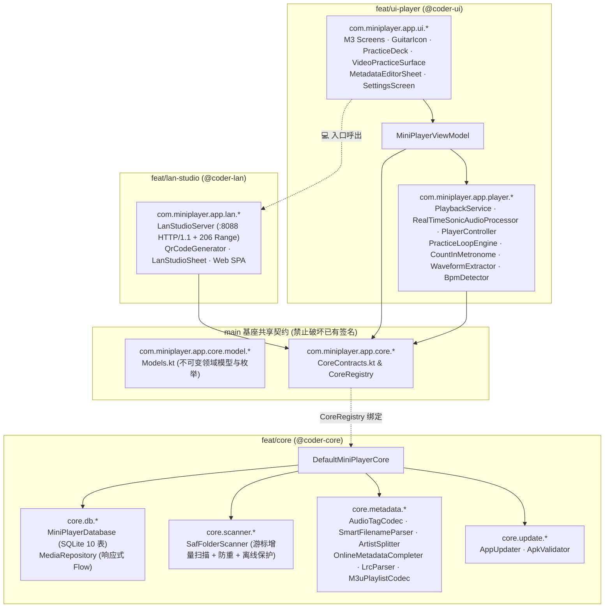

# MiniPlayer — 系统架构与模块契约规范 (Architecture & Module Contracts)

> **版本**：v1.0.4 (`versionCode = 10004`, `applicationId = "com.miniplayer.app"`, `minSdk = 26`, `targetSdk = 35`)  
> **配套产品设计文档**：[DESIGN.md](./DESIGN.md)  
> **构建与离线环境**：Kotlin `2.0.21` · AGP `8.7.1` · Jetpack Compose BOM `2024.10.01` (Material 3 `1.3.1`) · AndroidX Media3 `1.5.1` · SQLite (`SQLiteOpenHelper` + Kotlin `StateFlow`)

---

## 1. 模块分层与并行开发边界 (Module Ownership & Worktree Isolation)

为支持多模块零冲突并行开发，代码库按严格包边界切分为 **共享契约层 (`main` 基座)**、**核心数据与元数据层 (`feat/core`)** 与 **Media3 播放引擎及 Compose M3 界面层 (`feat/ui-player`)**：



### 1.1 工作树目录与文件独占归属规则（零合并冲突保证）

| 角色 / 分支 | 隔离工作树路径 | 独占新增/修改范围 | 严禁触碰的文件（防止合并冲突） |
|---|---|---|---|
| **基座 (`main`)** | `/usr/local/google/home/chii/Developer/miniplayer` | Gradle 构建脚本、`AndroidManifest.xml`、`res/` 基础资源、`core/model/Models.kt`、`core/CoreContracts.kt` | — |
| **`@coder-core` (`feat/core`)** | `.worktrees/coder-core` | `core/DefaultMiniPlayerCore.kt`、`core/db/**`、`core/scanner/**`、`core/metadata/**`、`core/update/**`、`app/src/test/java/com/miniplayer/app/core/**` | **严禁修改** `MainActivity.kt`、`MiniPlayerApplication.kt`、`player/**`、`ui/**`、`lan/**`、`AndroidManifest.xml`、`build.gradle.kts` |
| **`@coder-ui` (`feat/ui-player`)** | `.worktrees/coder-ui` | `MainActivity.kt`、`MiniPlayerApplication.kt`、`player/**`、`ui/**`（预留 `💻` 顶栏按钮与设置入口回调） | **严禁修改** `core/db/**`、`core/scanner/**`、`core/metadata/**`、`core/update/**`、`lan/**`、`build.gradle.kts` |
| **`@coder-lan` (`feat/lan-studio`)** | `.worktrees/coder-lan` | `lan/LanStudioServer.kt`、`lan/QrCodeGenerator.kt`、`lan/LanStudioSheet.kt` 及 `lan/**` 内部辅助类、`app/src/test/java/com/miniplayer/app/lan/**` | **严禁修改** `core/**`、`player/**`、`ui/**`、`MainActivity.kt`、`build.gradle.kts` |
| **`@tester` (`feat/verify`)** | `.worktrees/tester` | 合并 `feat/core` + `feat/ui-player` + `feat/lan-studio`、挂接 `LanStudioSheet`、集成测试 `app/src/test/**`、`README.md`、`TEST_REPORT.md`、Release 打包与 GitHub 发布 | — |

> **关键离线构建约束**：本地 Gradle 离线缓存已预置 `media3-exoplayer:1.5.1`、`media3-session:1.5.1`、`media3-common:1.5.1`、`media3-extractor:1.5.1`、`media3-datasource:1.5.1`、`media3-decoder:1.5.1`、`media3-container:1.5.1`（已全部配入 `app/build.gradle.kts`）。**注意本地离线缓存不含 `media3-ui`**：视频渲染统一使用 Jetpack Compose `AndroidView(factory = { TextureView(it) })` 配合 `exoPlayer.setVideoTextureView(textureView)`，天然完美支持 `1.0x–4.0x` 缩放平移变换与 `scaleX = -1f` 水平镜像翻转！

---

## 2. SQLite 数据库完整 DDL 规范 (`core/db/MiniPlayerDatabase.kt`)

采用原生高性能 `SQLiteOpenHelper`（开启 `WAL` 并发读写模式与 `PRAGMA foreign_keys = ON`）配合协程 `Dispatchers.IO` 与 `MutableStateFlow` 失效通知机制（避免离线环境 KSP 注解处理器依赖问题）：

```sql
-- 1. 受控 SAF 根目录表
CREATE TABLE saf_roots (
    root_id INTEGER PRIMARY KEY AUTOINCREMENT,
    tree_uri TEXT NOT NULL UNIQUE,
    tree_doc_id TEXT NOT NULL,           -- 用于父子目录重叠检测 (如 primary:Music vs primary:Music/Lossless)
    display_name TEXT NOT NULL,
    is_writable INTEGER NOT NULL DEFAULT 0,
    mount_state TEXT NOT NULL DEFAULT 'MOUNTED', -- MOUNTED | OFFLINE_UNMOUNTED | PERMISSION_REVOKED
    last_scan_at INTEGER NOT NULL DEFAULT 0
);

-- 2. 任意层级文件夹规则表 (DATABASE_VERSION = 2; 支持根或任意子文件夹标记练习文件夹与「不自动归类」，并通过 onUpgrade/onOpen 安全幂等迁移列)
CREATE TABLE folder_rules (
    folder_uri TEXT PRIMARY KEY,
    root_id INTEGER NOT NULL REFERENCES saf_roots(root_id) ON DELETE CASCADE,
    rel_path TEXT NOT NULL,              -- 相对根目录路径，如 "" (根) 或 "Backing/J-Rock"
    is_practice_folder INTEGER NOT NULL DEFAULT 0,
    exclude_from_grouping INTEGER NOT NULL DEFAULT 0, -- 1 表示该目录及继承子目录不参与专辑/歌手/视频自动归类
    respect_nomedia INTEGER              -- 历史兼容保留列；扫描器始终忽略 .nomedia 完整索引媒体
);
CREATE INDEX idx_folder_rules_root_path ON folder_rules(root_id, rel_path);

-- 3. 音视频媒体主表
CREATE TABLE media_items (
    item_id INTEGER PRIMARY KEY AUTOINCREMENT,
    document_uri TEXT NOT NULL UNIQUE,
    root_id INTEGER NOT NULL REFERENCES saf_roots(root_id) ON DELETE CASCADE,
    parent_rel_path TEXT NOT NULL DEFAULT '',
    file_name TEXT NOT NULL,
    mime_type TEXT NOT NULL,
    is_video INTEGER NOT NULL DEFAULT 0,
    size_bytes INTEGER NOT NULL DEFAULT 0,
    last_modified INTEGER NOT NULL DEFAULT 0,
    duration_ms INTEGER NOT NULL DEFAULT 0,
    width INTEGER NOT NULL DEFAULT 0,
    height INTEGER NOT NULL DEFAULT 0,
    raw_title TEXT,
    raw_artist TEXT,
    raw_album TEXT,
    raw_album_artist TEXT,
    raw_track_num INTEGER,
    raw_year INTEGER,
    parsed_title TEXT NOT NULL,          -- SmartFilenameParser 预清洗标题
    parsed_artist TEXT,                  -- SmartFilenameParser 路径/文件名推断歌手
    parsed_album TEXT,                   -- SmartFilenameParser 路径推断专辑
    is_backing_track INTEGER NOT NULL DEFAULT 0,
    embedded_cover_path TEXT,            -- 缓存的内嵌封面或视频关键帧缩略图路径
    folder_cover_uri TEXT,               -- 同目录 cover.jpg / folder.jpg URI
    fingerprint_key TEXT NOT NULL,       -- "${file_name.lowercase()}|${size_bytes}|${duration_ms}" 用于移动后迁移书签
    last_position_ms INTEGER NOT NULL DEFAULT 0,
    last_played_at INTEGER NOT NULL DEFAULT 0
);
CREATE INDEX idx_media_root_parent ON media_items(root_id, parent_rel_path);
CREATE INDEX idx_media_fingerprint ON media_items(fingerprint_key);
CREATE INDEX idx_media_is_video ON media_items(is_video);

-- 4. 第 1 层本地元数据覆盖表 (<5ms 瞬时生效，非破坏性)
CREATE TABLE media_metadata_overrides (
    item_id INTEGER PRIMARY KEY REFERENCES media_items(item_id) ON DELETE CASCADE,
    title TEXT,
    artist TEXT,
    album TEXT,
    album_artist TEXT,
    track_num INTEGER,
    year INTEGER,
    cover_local_path TEXT,
    updated_at INTEGER NOT NULL,
    synced_to_file INTEGER NOT NULL DEFAULT 0
);

-- 5. 多歌手拆分交叉索引表
CREATE TABLE media_item_artists (
    item_id INTEGER NOT NULL REFERENCES media_items(item_id) ON DELETE CASCADE,
    artist_norm TEXT NOT NULL,
    artist_display TEXT NOT NULL,
    ord INTEGER NOT NULL DEFAULT 0,
    PRIMARY KEY (item_id, artist_norm)
);
CREATE INDEX idx_artist_norm ON media_item_artists(artist_norm);

-- 6. 播放列表与明细表 (支持普通列表与 🎯 练习列表，支持音视频混排)
CREATE TABLE playlists (
    playlist_id INTEGER PRIMARY KEY AUTOINCREMENT,
    name TEXT NOT NULL,
    is_practice_playlist INTEGER NOT NULL DEFAULT 0,
    created_at INTEGER NOT NULL,
    updated_at INTEGER NOT NULL
);

CREATE TABLE playlist_items (
    playlist_id INTEGER NOT NULL REFERENCES playlists(playlist_id) ON DELETE CASCADE,
    item_id INTEGER NOT NULL REFERENCES media_items(item_id) ON DELETE CASCADE,
    sort_order INTEGER NOT NULL,
    added_at INTEGER NOT NULL,
    PRIMARY KEY (playlist_id, item_id)
);
CREATE INDEX idx_playlist_sort ON playlist_items(playlist_id, sort_order);

-- 7. 单曲练习状态记忆表
CREATE TABLE track_practice_states (
    item_id INTEGER PRIMARY KEY REFERENCES media_items(item_id) ON DELETE CASCADE,
    practice_speed REAL NOT NULL DEFAULT 1.0,
    pitch_semitones INTEGER NOT NULL DEFAULT 0,
    pitch_cents INTEGER NOT NULL DEFAULT 0,
    bpm INTEGER NOT NULL DEFAULT 120,
    count_in_mode TEXT NOT NULL DEFAULT 'OFF', -- OFF | SEC_1 | SEC_2 | BEAT_4
    pre_roll_enabled INTEGER NOT NULL DEFAULT 0,
    loop_enabled INTEGER NOT NULL DEFAULT 0,
    active_a_ms INTEGER,
    active_b_ms INTEGER,
    video_mirror INTEGER NOT NULL DEFAULT 0,
    video_zoom REAL NOT NULL DEFAULT 1.0,
    hud_dock_top INTEGER NOT NULL DEFAULT 0,
    video_seek_mode TEXT NOT NULL DEFAULT 'AUTO', -- AUTO | EXACT
    updated_at INTEGER NOT NULL
);

-- 8. 命名段落书签表 (Intro / Verse / Chorus / Solo 1 等)
CREATE TABLE practice_bookmarks (
    bookmark_id INTEGER PRIMARY KEY AUTOINCREMENT,
    item_id INTEGER NOT NULL REFERENCES media_items(item_id) ON DELETE CASCADE,
    label TEXT NOT NULL,
    a_ms INTEGER NOT NULL,
    b_ms INTEGER NOT NULL,
    saved_speed REAL,
    created_at INTEGER NOT NULL
);
CREATE INDEX idx_bookmarks_item_a ON practice_bookmarks(item_id, a_ms);

-- 9. 歌词缓存表 (内嵌 / 同目录 .lrc / LRCLIB 联网)
CREATE TABLE lyrics_cache (
    item_id INTEGER PRIMARY KEY REFERENCES media_items(item_id) ON DELETE CASCADE,
    synced_lrc TEXT,
    plain_lyrics TEXT,
    source TEXT NOT NULL,                -- EMBEDDED | LOCAL_LRC | LRCLIB
    source_modified_at INTEGER NOT NULL DEFAULT 0
);

-- 10. 极简全局偏好键值表
CREATE TABLE app_settings (
    pref_key TEXT PRIMARY KEY,
    pref_value TEXT NOT NULL
);
```

---

## 3. 共享契约与动态服务注册 (`Models.kt` & `CoreContracts.kt`)

为保证 `@coder-core` 与 `@coder-ui` 在各自独立工作树内**无需等待对方即可直接编译通过并运行测试**：
1. `core/model/Models.kt` 完整定义了所有不可变模型与纯函数辅助工具（包含半音/音分转 `PlaybackParameters.pitch` 的精确数学工具 `PracticeMath.computePitchFactor(semitones, cents)`、节拍间隔计算 `PracticeMath.computeClickIntervalMs(bpm, speed)`、`tnum` 时间格式化等）。
2. `core/CoreContracts.kt` 定义了四大核心接口与总门面 `MiniPlayerCoreProvider`：
   - `MediaLibraryContract`：响应式 `StateFlow` 观察文件夹树/平铺、专辑聚合（含 `未知专辑`）、歌手聚合、视频列表、播放列表（含 `🎯 练习列表`）、书签聚合、单曲练习状态与全局设置，以及增删改方法。
   - `FolderScannerContract`：添加 SAF 根目录（返回 `AddRootResult`：成功 / 已包含在父目录 / 已自动合并旧子目录）、增量重扫全部或单个根目录、移除根目录、切换任意目录/子目录 `练习文件夹` 与 `不自动归类 (exclude_from_grouping)` 规则（扫描始终忽略 `.nomedia`）。
   - `MetadataEngineContract`：保存单曲或批量 `MetadataDraft`（第 1 层数据库覆盖 + 可选第 2 层 SAF 原子写回）、恢复原始标签、单曲免 Key 联网候选检索（`searchOnlineCandidates`）、文件夹/`未知专辑`批量匹配预览（`previewBatchCompletion`）与批量提交、获取同步 `.lrc` 歌词、`.m3u/.m3u8` 导入导出。
   - `AppUpdateContract`：检查 GitHub Releases 最新版本、带进度与 SHA-256 + 签名校验下载 APK、触发 `FileProvider` 安装 Intent。
3. **`CoreRegistry.get(context)` 零冲突解耦绑定**：
   - `@coder-core` 在 `feat/core` 分支实现 `com.miniplayer.app.core.DefaultMiniPlayerCore(context: Context) : MiniPlayerCoreProvider`。
   - `CoreRegistry` 通过反射优先加载 `DefaultMiniPlayerCore(context)`；当 `@coder-ui` 在隔离分支单独编译调试时自动回退至内置内存态 `InMemoryPreviewCore`，合入 `feat/verify` 后自动零改动激活真实引擎！

---

## 4. `feat/core` 关键工程实现契约 (`@coder-core`)

1. **有效元数据计算 (`COALESCE` 链)**：
   - `effectiveTitle = override.title?.takeIf { it.isNotBlank() } ?: rawTitle?.takeIf { it.isNotBlank() } ?: parsedTitle`
   - `effectiveArtist = override.artist?.takeIf { it.isNotBlank() } ?: rawArtist?.takeIf { it.isNotBlank() } ?: parsedArtist ?: "未知歌手"`
   - `effectiveAlbum = override.album?.takeIf { it.isNotBlank() } ?: rawAlbum?.takeIf { it.isNotBlank() } ?: parsedAlbum`（若为空或空白，归入 `AlbumSummary.UNKNOWN_ALBUM_KEY`，标题显示 `"未知专辑"`，`isUnknownAlbum = true`）。
   - 每次写入/清除 `media_metadata_overrides` 或新文件入库时，同步通过 `ArtistSplitter.split(effectiveArtist, effectiveAlbumArtist)` 重建该曲目的 `media_item_artists` 行，并发出响应式刷新信号。
2. **子目录 `folder_rules` 最近祖先继承算法**：
   - 判断某文件 `(root_id, parent_rel_path)` 是否属于 `练习文件夹` (`isPracticeFolder`) 或 `不自动归类` (`isExcludedFromAutoGrouping`) 时，沿路径前缀向上匹配 `folder_rules`（例如 `"Backing/J-Rock"` 依次匹配 `"Backing/J-Rock"` → `"Backing"` → `""`），命中最近一条显式规则即采用其对应字段值；子目录切换单项开关时自动继承并保留另一项有效属性。
3. **SAF 扫描离线保护与防重 (`SafFolderScanner.kt`)**：
   - 先校验 `contentResolver.persistedUriPermissions` 是否包含该 `treeUri`（缺失则标为 `PERMISSION_REVOKED`）；再尝试查询根文档游标（若抛出异常或返回 `null`/不可读则标为 `OFFLINE_UNMOUNTED`），**严禁删除该 `root_id` 下的任何 `media_items` 或书签**。
   - 仅在 `mount_state == MOUNTED` 且游标完整遍历成功时，对消失的 URI 先尝试 `fingerprint_key` 迁移绑定，确系删除的文件再清理记录。
4. **二进制音频标签安全编解码 (`AudioTagCodec.kt`)**：
   - 支持纯 JVM 解析与重写：`.mp3` (**ID3v2.3 / ID3v2.4** `TIT2/TPE1/TALB/TPE2/TRCK/TDRC/APIC`)、`.flac` (**FLAC Metadata Blocks** `VORBIS_COMMENT` type=4 + `PICTURE` type=6)、`.ogg/.opus` (Vorbis Comment packet)、`.m4a/.mp4` (`moov.udta.meta.ilst` `©nam/©ART/©alb/aART/trkn/©day/covr`)。
   - **MP4 偏移修正铁律**：当 `moov` 原子位于 `mdat` 音频载荷之前且改写 `ilst` 导致 `moov` 字节长度变化 $\Delta$ 时，必须遍历所有 `trak.mdia.minf.stbl` 下的 `stco`（32位偏移 +$\Delta$；若溢出则升级）与 `co64`（64位偏移 +$\Delta$）同步修正偏移表！
   - **SAF 落盘铁律**：先在 `cacheDir/tag_stage/<itemId>.tmp` 生成完整新文件并二次读取校验头部合法性，再通过 `contentResolver.openFileDescriptor(docUri, "rw")` 覆写并调用 `Os.ftruncate(pfd.fileDescriptor, tmpFile.length())` + `Os.fsync(pfd.fileDescriptor)`。
5. **免 Key 自动联网补全 (`OnlineMetadataCompleter.kt`)**：
   - `MusicBrainzClient`：携带 `User-Agent: MiniPlayer/1.0.0 (https://github.com/codescv/miniplayer)`，内置 `Mutex + lastRequestMs` 实现 `1000 ms` 最小请求间隔。
   - **CAA `3.0s` 超时竞速回退**：查询封面时对 `coverartarchive.org/release/{mbid}/front-500` 设置 `connectTimeout = 3000, readTimeout = 3000`；若超时或非 `200`，立即采用并发/备选 `ItunesSearchClient` 返回的 `1000x1000bb.jpg` URL。

---

## 5. `feat/ui-player` 关键工程实现契约 (`@coder-ui`)

1. **`PlaybackService.kt` (`MediaSessionService`) & `RealTimeSonicAudioProcessor.kt` (`v1.0.2`)**：
   - Manifest 声明 `android:foregroundServiceType="mediaPlayback"` 与 `androidx.media3.session.MediaSessionService` Intent Filter。
   - `ExoPlayer.Builder(this)` 配置 `AudioAttributes` (`USAGE_MEDIA`, `AUDIO_CONTENT_TYPE_MUSIC`)、`handleAudioFocus = true`、**`setHandleAudioBecomingNoisy(true)`**。
   - **零寻址实时变调管线 (`RealTimeSonicAudioProcessor` + `RealTimeAudioProcessorChain`)**：`DefaultAudioSink` 关闭浮点输出与硬件 `AudioTrack` 倍速参数，注入常驻激活（`isActive() == true`）的 `RealTimeSonicAudioProcessor`。连续点击升降调时，处理器在 `queueInput` 内将旧 `SonicAudioProcessor` 残余采样排空拼接至直接内存 `stagingBuffer` 并原地切换参数，`PlayerController` 绝不调用 `exoPlayer.seekTo`、亦不在 `exoPlayer.playbackParameters` 上变动 `pitch`，从而避免 `AudioTrack` 重建与解码器冲洗。
   - 视频熄屏续播：当 Activity 进入后台/熄屏时仅调用 `exoPlayer.clearVideoTextureView(surface)` 而不调用 `pause()`，使视频音轨在后台零中断继续播放；Activity 回到前台时重新绑定 `TextureView`。
2. **`PracticeLoopEngine.kt`、`WaveformLoopRuler` & `BpmDetector.kt` (`v1.0.2`)**：
   - 所有 `ExoPlayer` API 调用严格运行在主线程 (`exoPlayer.applicationLooper`)。
   - A-B 循环边界通过 `exoPlayer.createMessage { _, _ -> handleLoopWrap() }.setLooper(exoPlayer.applicationLooper).setPosition(bMs).setDeleteAfterDelivery(false).send()` 注册；任何修改 `aMs`/`bMs`、挂起循环、切换曲目或手动 `seekTo` 前必须先执行 `activeMessage?.cancel()`。
   - **1:1 浮点手柄拖拽 (`WaveformLoopRuler`)**：`.pointerInput(safeDuration)` 严格仅以 `safeDuration` 为 Key，内部通过 `rememberUpdatedState` 读取实时 `activeAMs`/`activeBMs` 并记录手指抓取偏移 `dragGrabOffsetPx`，拖拽中调用 `setLoopPointsFromDrag(..., commitPersist = false)` 实时移动标尺，松手时 `commitPersist = true` 落库并重排 `PlayerMessage`。
   - **自动 BPM 检测 (`BpmDetector` + `WaveformExtractor.loadOrDetectBpm`)**：优先命中 `cacheDir/waveforms/bpm_<id>_<mtime>.dat` 缓存或内嵌 `TBPM` 标签；否则利用 `MediaExtractor` + `MediaCodec` 跳过前奏截取最多约 20 秒 16-bit PCM 送入 `OnsetFluxAccumulator`（`100 Hz` 能量差分包络 + `45–220 BPM` 自相关与倍频谐波加权），当曲目处于默认 `120 BPM` 时自动回填，并支持 UI 随时展开 `BpmQuickBar` 一键点击 `"自动"` 重测。
   - 视频连续循环（`countInMode == OFF`）：记录 `seekStartRealtimeMs` 至 `Player.Listener.onRenderedFirstFrame`（或 `onPlaybackStateChanged(STATE_READY)`）耗时；若 `> 80 ms` 且 `videoSeekMode == AUTO`，自动将 `exoPlayer.setSeekParameters(SeekParameters(1_500_000L, 0L))` 应用于后续循环绕回。
3. **练习模式确定性状态机与专属视觉标识 (`MiniPlayerViewModel.kt` & `GuitarIcon.kt`)**：
   - 全应用（日常播放页、练习顶栏、横屏视频 HUD、曲库/列表菜单）统一采用自绘矢量吉他图标 **`GuitarIcon`** 标识练习模式，屏幕常亮采用纯图标切换按钮（`DeckIconToggleButton` + `Icons.Outlined.LightMode`）。
   - 点播入口携带 `PlayContext` 枚举：`PRACTICE_PLAYLIST` | `PRACTICE_FOLDER` | `BOOKMARK_JUMP(bookmarkId)` | `CASUAL`。
   - 前三者立即置 `isPracticeModeActive = true`、展开 `PracticeDeck` 并应用 `PracticeState`（倍速 + 半音/音分 + BPM + A/B 区间）；`CASUAL` 置 `isPracticeModeActive = false`、播放参数保持 `(1.0f, 1.0f)`。

---

## 6. 应用内 GitHub 自动更新安全规范 (`core/update/`)

1. **接口与配置**：读取 `BuildConfig.UPDATE_API_BASE`（默认 `"https://api.github.com/repos/codescv/miniplayer"`）：
   - `latestUrl = "${BuildConfig.UPDATE_API_BASE}/releases/latest"`
   - `listUrl = "${BuildConfig.UPDATE_API_BASE}/releases?per_page=5"`
2. **网络与重定向防护 (`AppUpdater.kt`)**：
   - 默认强制 `https://`（仅单元测试注入 `allowInsecureLoopback = true` 时允许 `http://127.0.0.1` / `localhost`）。
   - 关闭 `HttpURLConnection.instanceFollowRedirects`，手动处理 `301/302/303/307/308`，最多 **5 跳**，严禁 `HTTPS -> HTTP` 协议降级；JSON 响应上限 `2 MiB`。
   - 若 Release Assets 中存在 `SHA256SUMS.txt`，自动拉取并比对所选 `.apk` 文件的 SHA-256 摘要（不匹配立即删除 `.tmp` 并抛出 `CORRUPT_DOWNLOAD`）。
3. **APK 安装包四重校验 (`ApkValidator.kt`)**：
   - ① ZIP 魔数 `PK\x03\x04` 且内含 `AndroidManifest.xml`；
   - ② `PackageManager.getPackageArchiveInfo` 解析出的 `packageName == context.packageName` (`com.miniplayer.app`)；
   - ③ 新包 `longVersionCode > currentVersionCode`（严防版本降级攻击）；
   - ④ 签名证书集合与当前已安装宿主应用签名证书完全一致。
4. **安全拉起安装**：落盘至 `context.cacheDir/updates/MiniPlayer-<tag>.apk`，通过 `FileProvider.getUriForFile(context, "${context.packageName}.fileprovider", apkFile)` 构造 `Intent.ACTION_VIEW`（若 `canRequestPackageInstalls()` 为 `false` 则先引导跳转 `Settings.ACTION_MANAGE_UNKNOWN_APP_SOURCES`）。

---

## 7. 内置 PC 局域网 Web 管理台协议规范 (`com.miniplayer.app.lan.*`, `@coder-lan`)

1. **核心组件**：
   - `QrCodeGenerator.kt`：零第三方依赖的纯 Kotlin ISO/IEC 18004 二维码矩阵生成器，在手机端渲染 `http://<lan-ip>:8088` 扫码图。
   - `LanStudioServer.kt`：基于纯 JVM `ServerSocket` + 协程线程池实现的轻量 HTTP/1.1 服务（默认端口 `8088`，单元测试支持传 `0` 绑定随机空闲端口），直接桥接 `MiniPlayerCoreProvider`。
   - `LanStudioSheet.kt`：Jetpack Compose M3 模态面板，展示服务运行状态、局域网 IP 地址、二维码画布、一键复制地址、请求计数与启停开关。
2. **网络访问控制与安全边界**：
   - **私有局域网 IP 防火墙**：`accept()` 后立即校验对端 `InetAddress`，仅放行回环与局域网私网段（`127.0.0.0/8` / `::1`、`10.0.0.0/8`、`172.16.0.0/12`、`192.168.0.0/16`、链路本地 `169.254.0.0/16` / `fe80::/10`），一切公网 IP 连接立即返回 `403 Forbidden` 并断开。
   - 支持可选会话 PIN / Bearer Token 校验与上传文件名路径穿越清洗（剥离 `..`、`/`、`\` 与控制字符）。
3. **REST API 与 HTTP `206` 媒体流端点规范**：
   - `GET /`：返回单页内联响应式 M3 风格 **PC Web Studio SPA**（纯原生 HTML5/CSS3/ES2022，支持深浅色自适应）。
   - **目录与无线上传**：
     - `GET /api/roots` · `GET /api/folders?rootId=&relPath=`：列出 SAF 根目录与子目录内容。
     - `POST /api/upload?rootId=&relPath=&fileName=`：流式接收二进制或 `multipart/form-data` 上传文件写入目标 SAF 目录（或测试目录），写入完成后自动调用 `scanner.rescanRoot(rootId, incremental = true)` 即刻入库。
     - `POST /api/folders/mkdir` · `POST /api/folders/rule`：新建子文件夹、一键切换子文件夹 `🎯 设为练习文件夹` (`isPracticeFolder`)。
   - **曲库表格与免 Key 联网补全**：
     - `GET /api/items?view=all|albums|artists|videos&q=`：返回曲库列表与有效标签、练习摘要。
     - `POST /api/metadata/update` · `POST /api/metadata/batch-update`：单曲或批量（遵循 `dirtyFields` 保护单曲标题/音轨号）保存标签。
     - `POST /api/metadata/auto-match?itemId=` · `POST /api/metadata/batch-auto-complete`：调用 `MetadataEngineContract` 执行免 Key 联网候选检索与批量自动补全。
   - **播放列表与 `🎯 练习列表` 编排**：
     - `GET /api/playlists` · `POST /api/playlists` · `PUT /api/playlists/{id}` · `DELETE /api/playlists/{id}`：增删改播放列表、切换 `isPracticePlaylist`、调整曲序。
     - `POST /api/playlists/import` · `GET /api/playlists/export?id=`：`.m3u8` 导入导出。
   - **PC 在线预听与键盘 `[` / `]` 段落书签工作台**：
     - `GET /api/stream?itemId=`：支持标准 **HTTP `206 Partial Content`**（解析 `Range: bytes=start-end` 请求头，返回 `Content-Range: bytes start-end/total` 与 `Accept-Ranges: bytes`），使 PC 浏览器 `<audio>` / `<video>` 元素可毫秒级任意拖拽进度条！
     - `GET /api/practice?itemId=` · `POST /api/practice/state` · `POST /api/practice/bookmark` · `DELETE /api/practice/bookmark?id=`：读写单曲 `PracticeState`（倍速、半音、音分、BPM）与命名 `PracticeBookmark`（PC 端支持快捷键 `Space` 播停、`[` 设 A、`]` 设 B 一键存书签，手机端打开即用）。
