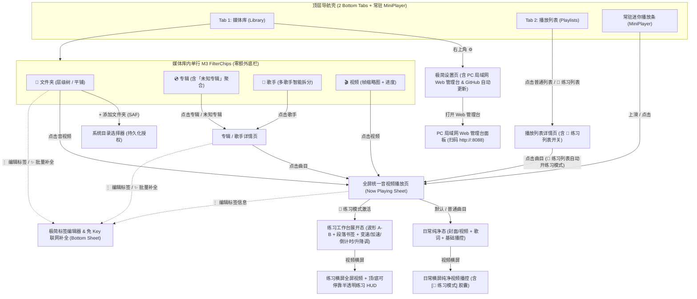
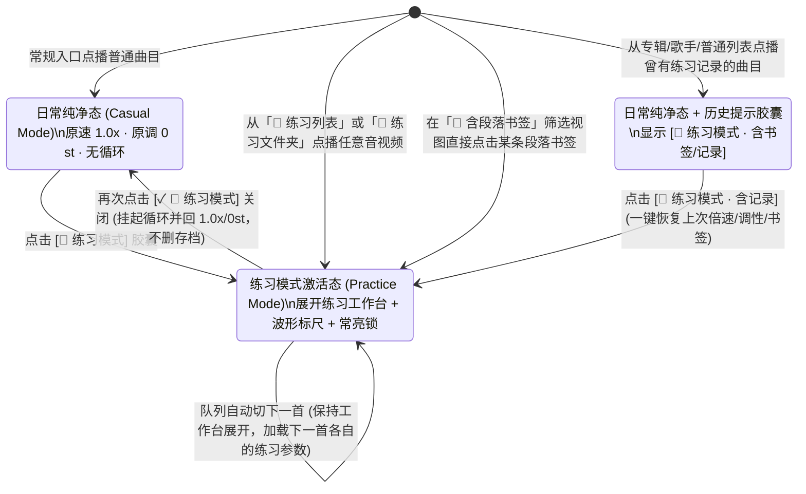

# MiniPlayer — 产品与 UX/UI 设计规范 (Product & UX Design)

> 一款专为 **Android** 打造的**极简本地音视频播放器**（内附免安装的 **PC 局域网 Web 管理台**）：遵循纯正 **Google Material Design 3 (Material You)** 视觉规范，**只扫描用户显式添加的本地文件夹**（零全局扫盘污染、零流媒体广告、零账号体系），并在**同一套极简无 Emoji 界面**中通过渐进式披露无缝融合**日常听歌/看视频**与乐器/扒谱场景下的**「练习模式 (Practice Mode)」**（A-B 毫秒级循环、段落书签、变速不变调慢放、循环前预备倒计时、零静音半音升降调、练习常亮开关、视频局部缩放与镜像），同时支持**练习文件夹曲库隔离**、**专辑/歌手自动聚合**、**极简标签编辑**、**免 Key 自动联网补全**、**PC 浏览器无线传歌/打点编排**以及**应用内 GitHub 安全自动更新**。

---

## 1. 产品原则 (Product Principles)

| # | 核心原则 | 设计推论与界面约束 |
|---|---|---|
| **P1** | **严格受控的本地边界（我的媒体库只属于我）** | 绝不申请全局 `READ_MEDIA_AUDIO` / `READ_MEDIA_VIDEO` 扫盘权限，绝不把系统铃声、通话录音、社交软件语音碎片扫进曲库。**只扫描用户通过 SAF 显式添加的文件夹**。 |
| **P2** | **日常极简，专业按需（渐进式披露）** | 普通听歌或看本地视频时，播放页只有封面/画面、进度条与基础播控，零多余按钮；仅在进入**「练习列表 / 练习文件夹」**或点按 **`[ 🎯 练习模式 ]`** 时，平滑展开**练习工作台 (Practice Deck)**。 |
| **P3** | **音视频同构（同一播放器，同一工作台）** | `.mp3/.flac` 音频伴奏与 `.mp4/.mkv` 教学/滚屏曲谱视频共享完全一致的播放页、队列、A-B 循环、段落书签与变速升降调逻辑，拒绝割裂的「音乐播放器 + 视频播放器」双套 UI。 |
| **P4** | **单手持琴/持拨片人体工学优先** | 处于「练习模式」时，双手往往持乐器（如左手按指板、右手捏拨片），核心高频动作（设 A/B 点、切段落书签、切倍速、倒计时重来）必须 **1 次大触控热区点击（≥ 48–56 dp）**直达，绝不依赖精细拖拽小滑块或多层菜单。 |
| **P5** | **零配置离线可用，联网补全纯按需且免 Key** | 安装即用，完全离线运行；仅在用户主动触发「自动联网匹配」标签/封面/歌词时，调用开放免 Key 接口（MusicBrainz / Cover Art Archive / iTunes / LRCLIB），且通过本地数据库覆盖层毫秒级生效。 |
| **P6** | **纯正 Material You 原生克制感** | 100% 遵循 Android Material 3 组件、动态取色（壁纸主色 + 播放页封面柔和色板）、Edge-to-Edge 沉浸式系统栏与预测式返回手势（Predictive Back），零自定义花哨皮肤。 |

---

## 2. 功能边界 (Scope)

### 2.1 保留并打磨的核心能力 (Kept)

| 模块 | 核心能力 | MiniPlayer 极简呈现方式 |
|---|---|---|
| **受控本地源** | Android SAF 目录树挂载（`ACTION_OPEN_DOCUMENT_TREE` 持久化读写授权，支持内置存储、SD 卡、USB OTG）、增量极速重扫、始终忽略 `.nomedia` 完整扫描目录内全部媒体 | `媒体库` 页右下角纯图标「添加文件夹」FAB，目录卡片一键增量刷新，纯图标切换层级树 `⇄` 平铺视图 |
| **四维媒体库视图与目录归类隔离** | 文件夹层级/平铺浏览（支持根文件夹、子文件夹及当前目录面包屑顶栏**一键全部添加到播放列表**）、按 `专辑 (Album)` 自动聚合、按 `歌手 (Artist)` 自动聚合（支持多歌手分隔符拆分）、本地 `视频 (Videos)` 缩略图流；**标记为「练习文件夹」或「不自动归类」的根目录及继承子目录自动从 `专辑 / 歌手 / 视频` 视图排除**（其中「不自动归类」目录点播仍保持日常纯净模式 `PlayContext.CASUAL`） | 严守底部 **2 个顶层 Tab**；在 Tab 1 `媒体库` 顶部用单行 **4 枚纯文字无 Emoji M3 `FilterChip`**（`文件夹` · `专辑` · `歌手` · `视频`）切换视图 |
| **极简标签与免 Key 补全** | 6 大核心字段编辑（标题、歌手、专辑、专辑歌手、音轨号/年份、封面）、双层持久化（本地数据库覆盖层 + 单次编辑可选写回原文件）、单曲一键匹配与未知专辑/文件夹批量自动补全、同步 `.lrc` 歌词获取 | 底部模态面板 `极简标签编辑器`（内置按次勾选写回原文件开关），提供 Top 候选卡片预览与批量置信度确认列表 |
| **播放列表与练习列表** | 自建播放列表、拖拽排序、`.m3u/.m3u8` 导入导出、一键标记 **`练习列表 (Practice Playlist)`** 或 **`练习文件夹`** | Tab 2 `播放列表`（全页零 Emoji + 右下角纯图标 `+` FAB）；开启 `练习列表` 开关后，点击其内任意曲目/视频自动激活「练习模式」 |
| **日常音视频播放** | 无缝后台播放（Media3 `MediaSessionService`）、锁屏/蓝牙/耳机线控、视频熄屏续播音频、内嵌/本地/联网 `.lrc` 同步歌词滚动、睡眠定时、播放队列 | 底部常驻 `MiniPlayer` 条 + 上滑全屏 `Now Playing` 面板（纯图标练习切换与加入列表按钮 + 光学垂直居中的 `词` 按钮） |
| **双行练习模式工作台** | 音频波形包络与小节线标尺预览、紧凑双行控制面板：第 1 行自动按小节对齐（`小节对齐`）的 A-B 循环（`[A]` / `[B]` / 回 A / 挂起 / 清除 + `N小节` 跨度提示 + 纯图标存书签）；第 2 行 `0.25x–2.0x` 倍速步进（`-5%` / `1.00x` / `+5%`）+ 纯图标开关（**纯粹时域 Sonic** `升降调`、**Meta `HTDemucs` (`htdemucs_6s`) 端侧五轨分离与时域混音**`分轨混音`、`关 ↔ 4拍` 一键`预备拍`、`BPM` 与`对齐第1拍`、`保持常亮`、视频`水平镜像`） | 统一播放页内的渐进式展开 **2 行 `练习工作台 (Practice Deck)`**，按曲目自动记忆全部练习状态 |
| **视频练习增强** | 视频画面 `1.0x–4.0x` 双指无级缩放与平移（看清指板手型/小字曲谱）、纯图标水平镜像翻转、横屏半透明防遮挡 HUD（支持顶/底停靠避让底部曲谱字幕）、练习工作台直控常亮开关 | 同一播放页的视频画布手势与浮层控件 |
| **PC 局域网 Web 管理台** | 手机按需开启纯本地 HTTP 服务（默认 `:8088` + 扫码直连），电脑浏览器免安装实现：**拖拽无线传伴奏/教学视频入 SAF 目录**、**大屏表格批量改标签与免 Key 联网补全**、**编排 `🎯 练习列表`**、**HTTP `206` 在线预听 + 键盘 `[`/`]` 快速打 A-B 段落书签** | 收纳于 `设置 -> 本地媒体库与无线连接 -> PC 局域网 Web 管理台`，平时关闭零耗电 |
| **应用内自动更新** | 对接 GitHub Releases (`codescv/miniplayer`) 检查新版、`SHA256SUMS.txt` 摘要与签名四重校验、`FileProvider` 一键安装 | `设置 -> 关于与自动更新` 单行内完成检查与升级 |

### 2.2 明确砍掉的臃肿功能 (Cut)

| 常见播放器臃肿功能 | 砍掉原因 |
|---|---|
| 全局 `MediaStore` 全盘自动扫描 | 彻底杜绝系统提示音、通话录音、微信语音、游戏音效污染曲库，且免去存储敏感权限弹窗。 |
| 在线音乐流媒体、每日推荐、广场、评论区、账号登录 | MiniPlayer 是纯粹的本地媒体与练习工具，零网络噪音、零广告、零隐私收集。 |
| 独立割裂的「专业扒谱 DAW 页面」或多轨混音台 | 破坏极简体验；渐进式「练习模式」在单页内即可解决 99% 的伴奏跟练、慢放扒谱与教学视频拆解需求。 |
| 10 段/31 段复杂图形均衡器、3D 环绕音效、重低音旋钮 | 保持原汁原味的音频解码与清晰的 Sonic 变速变调链路，不堆砌劣质 DSP 噱头。 |
| 听歌时长统计年报、徽章成就、花哨拟物黑胶唱针动画 | 视觉克制，封面/视频画面与声音本身才是主角。 |
| 40+ 字段的专业 ID3 十六进制标签编辑器 | 仅保留影响曲库归类与观感的 **6 个核心字段**，其余底层原始标签原样保留不破坏。 |
| 主题商店、自定义背景图、气泡字体、底栏数量自定义 | 严格跟随系统深浅色与 Material You 动态色彩规范。 |

**架构收敛结果**：全应用仅包含 **2 个底部导航 Tab、1 个常驻 MiniPlayer + 全屏统一播放面板、3 个轻量二级详情页（文件夹/专辑/歌手详情、播放列表详情、极简设置页）与 2 个核心功能 Bottom Sheet（练习配置浮层、极简标签编辑器）**。

---

## 3. 视觉语言与信息架构 (M3 Design System & IA)

### 3.1 Material Design 3 (Material You) 视觉规范

1. **动态色彩体系 (Dynamic Color & Scoped Album Tonal Palette)**：
   - **全局导航与列表层**：Android 12+ (API 31+) 默认启用 `dynamicLightColorScheme` / `dynamicDarkColorScheme`，从系统壁纸提取柔和主色；Android 8.0–11 回退至 Google 标准 M3 Tonal Spot 蓝灰基准色板。
   - **播放页局部封面取色**：进入全屏播放页时，通过 Material Color Utilities (`QuantizerCelebi` + `Score` → `SchemeTonalSpot`) 从当前曲目封面（或视频首帧缩略图）实时提取同色系 M3 柔和色板，以 `350 ms` 缓动动画过渡至播放页背景（`surfaceContainerLow`）与控件高亮色（`primaryContainer` / `secondaryContainer` / `tertiaryContainer`）。因为走标准 M3 色调映射而非生硬取原图纯色，深浅色模式下文字对比度始终严格满足 **WCAG AA (≥ 4.5:1)**。
2. **层级与容器 Token (Surface Container Hierarchy)**：
   - 弃用生硬分割线与重阴影，采用 M3 色调表面分层：页面底色 `surface` → 列表卡片/文件夹块 `surfaceContainerLow` → 常驻 `MiniPlayer` `surfaceContainerHigh` → 展开的**练习工作台 (Practice Deck)** `surfaceContainer`（圆角 `24 dp`） → 激活态 **`[ 🎯 练习模式 ]`** 与 A-B 循环区间采用 `tertiaryContainer` / `onTertiaryContainer`（与常规播放的 `primary` 形成清晰直觉区分：主色管播放，第三色管练习循环）。
   - **深色模式抬升表面 (Charcoal Dark Elevated Surfaces, `v1.0.7`)**：深色主题不再使用接近纯黑的 `#111318` 底色，改为 Google Material「Charcoal Dark」炭灰阶梯：`background` / `surface = #1E1F24`、`surfaceContainerLowest = #181A1F`、`surfaceContainerLow = #26282F`、`surfaceContainer = #2B2E36`、`surfaceContainerHigh = #32353E`、`surfaceContainerHighest = #3B3E48`（`Theme.kt` `DefaultDarkScheme`）。Android 12+ 动态取色时由 `elevateDynamicDarkSurfaces()` 将 Material You 深色色板整体上抬一个色调台阶（`background` / `surface ← surfaceContainer`、`surfaceContainerLowest ← surface`、`surfaceContainerLow ← surfaceContainerHigh`、`surfaceContainer ← surfaceContainerHighest`、`surfaceContainerHigh ← surfaceBright`），确保列表卡片、底部弹层与常驻 `MiniPlayer` 在深色下仍保留可见的层级对比，而非糊成一片黑。
3. **排版与等宽数字防抖 (Typography & Tabular Figures)**：
   - 采用系统原生 Roboto / Noto Sans CJK 字体阶梯：`Title Large`（顶部栏/曲名）、`Body Large`（列表主标题）、`Body Medium`（歌手/副标题）、`Label Large`（Chip 与核心按钮）。
   - **关键细节**：所有时间戳（`02:14.3`）、A/B 点坐标、倍速（`0.75x`）、半音值（`-1 st`）与倒计时数字一律强制开启 OpenType 等宽数字特性 **`fontFeatureSettings = "tnum"`**，彻底消除播放跳秒与微调时文本宽度抖动。
4. **沉浸式系统栏与预测式返回 (Edge-to-Edge & Predictive Back)**：
   - 全屏启用 `enableEdgeToEdge()`，底部 `NavigationBar` 与全屏横竖屏视频自适应安全区 `WindowInsets`。
   - 完整接入 Android 14+ 预测式返回手势（`Predictive Back`）：当全屏播放页、标签编辑器或队列面板展开时，侧滑返回提供实时缩放预览并优先收起面板，而非意外退出应用。

### 3.2 全局信息架构图 (Information Architecture)



---

## 4. 核心页面与线框图设计 (Screens & Wireframes)

### 4.1 Tab 1：媒体库 (`Library`) — 单行纯文字 FilterChip 四视图、极简顶栏与默认自然名称序 (`v1.0.3`)

顶部采用极简 M3 `TopAppBar`（仅展示 `MiniPlayer` 标题与右侧唯一的 `设置` 图标入口，移除搜索、排序、刷新与 Web 管理台顶栏图标），紧接单行 4 枚纯文字无 Emoji 的 M3 `FilterChip`（`文件夹` · `专辑` · `歌手` · `视频`），不增加任何二级 Tab 嵌套；目录浏览区的「层级树 `⇄` 平铺」切换按钮与右下角「添加文件夹」FAB 均为纯图标按钮（无冗余文字标签）。
- **必选单选约束 (Mandatory Single-Selection)**：4 枚视图 `FilterChip` 始终有且仅有 1 枚处于选中态（类似 M3 单选分段行为），重复点击当前已选中的 Chip **不会取消选中导致白屏**，且切换视图时自动保持各视图独立的滚动位置。
- **练习文件夹与「不自动归类」曲库隔离 (`isInPracticeFolder` & `isExcludedFromAutoGrouping` Isolation, `v1.0.1` / `v1.0.4`)**：标记为「练习文件夹」（`isInPracticeFolder == true`）或「不自动归类」（`isExcludedFromAutoGrouping == true`）的根目录及其继承子目录中的所有音视频条目**自动从 `专辑`、`歌手` 与 `视频` 三个自动聚合视图排除**，同时完整保留在 `文件夹`（目录树与平铺浏览）、`播放列表` 与 `含段落书签` 视图中；两者区别在于「不自动归类」目录在 `文件夹` 内点播时仍按普通日常模式（`PlayContext.CASUAL`）播放，适合语音备忘录、播客、散装素材等无需练习台但不想混入专辑/歌手的文件夹。
- **统一默认自然名称序 (`SortOrder.NAME_ASC`, `v1.0.3`)**：全媒体库四视图统一按默认自然字母/数字序（`Track 2 < Track 10`）稳定排列（`文件夹` 子目录置顶，`专辑` 视图中 `未知专辑` 兜底桶固定置于列表末尾），彻底省去排序菜单负担。

#### (A) `📁 文件夹 (Folders)` 视图与受控目录管理

```
┌──────────────────────────────────────────────┐
│ Play                                      ⚙  │
│ [✓ 📁 文件夹] [💿 专辑] [🎤 歌手] [🎬 视频]  │
├──────────────────────────────────────────────┤
│ 已添加的文件夹 (3)             [层级 ⇄ 平铺] │
│ ┌──────────────────────────────────────────┐ │
│ │ 📁 Lossless Music               142 首  ⋮│ │
│ │    内置存储 › Music › Lossless           │ │
│ └──────────────────────────────────────────┘ │
│ ┌──────────────────────────────────────────┐ │
│ │ 📁 Guitar Backing     [🎯 练习]  38 首  ⋮│ │
│ │    SD卡 › Music › Backing (或任意子目录) │ │
│ └──────────────────────────────────────────┘ │
│ ┌──────────────────────────────────────────┐ │
│ │ 📁 OTG 教学视频盘  [⚠️ 未挂载]   16 个  ⋮│ │
│ │    USB OTG › GuitarTabs (拔出时保留书签) │ │
│ └──────────────────────────────────────────┘ │
│                                              │
│                              [ + 添加文件夹 ]│
├──────────────────────────────────────────────┤
│ ▶  ┌──┐ Neon (Live Backing) · John Mayer     │
│    └──┘ 🎯 0.75x · Solo A-B 循环中           │
│ ━━━━━━━━━━━━━━━●━━━━━━━━━━━━━━━━━━━━━━━━━━━━ │
├──────────────────────────────────────────────┤
│         ◉ 媒体库              ○ 播放列表     │
└──────────────────────────────────────────────┘
```

- **空状态（首次启动零权限弹窗）**：展示清爽线性图标 + *「只扫描你指定的本地文件夹，绝不混入系统杂音」* + 主按钮 **`[ + 添加本地文件夹 ]`**（拉起系统 SAF `ACTION_OPEN_DOCUMENT_TREE`）。
- **子目录浏览、面包屑快捷加歌与目录规则继承 (`v1.0.4`)**：点击任一根文件夹进入目录内部，顶部浮现可横向滚动的**面包屑路径栏**（`Music › Backing › 结束バンド`），右侧紧邻 **`全部添加到播放列表` 快捷图标按钮**（`Icons.AutoMirrored.Outlined.PlaylistAdd`，将当前目录及子目录全部媒体按标题自然序一键送入列表选择器）与**层级目录树 (`层级`) `⇄` 平铺 (`平铺`)** 切换按钮。**不仅顶层 SAF 根目录，目录树内的任意子文件夹均可单独开启 `练习文件夹` 或 `不自动归类` 属性**，下级子孙目录按最近祖先规则自动继承并支持子级覆盖；受控文件夹扫描始终忽略 `.nomedia`。
- **重命名文件夹即时去重 (`v1.0.5`)**：在外部文件管理器把子目录 `rock` 改名为 `Rock`（仅大小写）或 `metal` 后，`文件夹` 视图**只显示新目录**，绝不同时出现 `Rock` 与 `rock`；目录内曲目、播放列表、段落书签、标签覆盖与 `练习文件夹` / `不自动归类` 规则随目录无缝迁移，已删除目录的旧规则不会再生成「幽灵目录」。正停留在旧路径（面包屑 `rock`）时自动跳转到 `Rock`；从后台切回应用时自动执行防抖增量重扫，无需手动刷新。
- **应用显示名 `Play` 与拨片启动图标 (`v1.0.5` / `v1.0.6` / `v1.0.7` / `v1.0.8`)**：桌面与媒体库顶栏统一显示 **`Play`**；自适应图标采用「版型 A」宽肩 351 吉他拨片 + 居中圆角播放三角（无外圈），并在 `108×108dp` 前景画布中按 **`0.60x`（`38.4dp × 37.8dp`，`x ∈ [34.8, 73.2]`，`y ∈ [36.5, 74.3]`）** 针对 Android `72×72dp`（`r = 35–36dp`）圆形桌面蒙版做光学居中（左右肩 `(34.8, 50.0)` / `(73.2, 50.0)` 距圆心 `(54, 54)` 半径 `19.6dp`，底尖 `(54, 74.3)` 距圆心 `20.3dp`，四周留出均匀 `15–16dp` 呼吸边距）；配色为 `1D · 珊瑚橙`：浅色主题 背景 `#F8FAFC` / 拨片 `#F97316` / 三角 `#FFFFFF`；深色主题（`v1.0.8` 磨砂炭灰底板）背景 `#282A30` / 拨片 `#FB923C` / 三角 `#FFFBEB`。
- **自绘磨砂炭灰深色图标底板，复刻 ColorOS / Discord / Google Maps 暗色图标底板 (`v1.0.8`)**：OnePlus 13T（ColorOS 15）真机验证表明，桌面内置「暗色图标」自动转换**仅对 Google Maps、Discord 等白名单 Play 商店包名生效**，自定义包名 `com.miniplayer.app` 不会被替换——`v1.0.7` 删除 `values-night` 后，深色模式下图标仍停留在浅色 `#FFFFFF` 底板上。`v1.0.8` **恢复 `res/values-night/colors.xml`**，并把 `drawable/ic_launcher_background.xml` 改为双 `<path>` 的 `aapt:attr` 渐变矢量：第一层为贯穿可见 `[18, 90]` 圆区的纵向线性渐变（`startX/endX = 54`，`startY = 16`，`endY = 92`；色标 `@color/ic_launcher_bg_top` `0.0` → `@color/ic_launcher_bg_mid` `0.48` → `@color/ic_launcher_bg_bottom` `1.0`），第二层为柔和的径向毛玻璃漫射高光（`type="radial"`，`centerX = 48`，`centerY = 32`，`gradientRadius = 46`；色标 `@color/ic_launcher_bg_glow_start` `0.0` → `@color/ic_launcher_bg_glow_mid` `0.55` → `#00FFFFFF` `1.0`）。**浅色 `1D`**（`values/colors.xml`）：`ic_launcher_background #F8FAFC`，`bg_top #FFFFFF` / `bg_mid #F8FAFC` / `bg_bottom #F1F5F9`，高光全透明 `#00FFFFFF`，拨片 `#F97316`，三角 `#FFFFFF`；**深色磨砂炭灰**（`values-night/colors.xml`）：`ic_launcher_background #282A30`，`bg_top #363940` / `bg_mid #282A30` / `bg_bottom #1E2025`，高光 `#1AFFFFFF` → `#09FFFFFF`，拨片 `#FB923C`，三角 `#FFFBEB`，由系统深色主题自动切换，呈现与 Discord / Google Maps 一致的非实色、略带磨砂质感的炭灰渐变底板。
- **交由系统生成毛玻璃深色图标底板（`v1.0.7`，已被 `v1.0.8` 取代）**：**移除 `values-night/colors.xml`**，`<background>` 固定为与 Google Maps 相同的纯白 `#FFFFFF`。ColorOS 15 / OxygenOS 15「暗色图标」桌面会检测到明亮/彩色的自适应图标 `<background>` 并替换为系统自带的半透明磨砂毛玻璃深色底板（Google Maps 与 Discord 正是如此）；此前 `values-night` 提供预先压暗的实色 `#0F172A` 时，桌面会跳过该替换而画出一个呆板的实心深色圆。拨片 `#F97316` 与三角 `#FFFFFF` 在深浅色系统主题下保持一致。
- **Android 13+ 主题图标 `evenOdd` 镂空 (`ic_launcher_monochrome.xml`, `v1.0.7`)**：`<monochrome>` 改为指向独立的 `@drawable/ic_launcher_monochrome`，它只有一条 `android:fillType="evenOdd"` 复合路径（`0.60x` 拨片轮廓 + 内部播放三角轮廓）。Android 13+ / 15 主题图标与 Material You 引擎会把整个 drawable 染成同一种颜色，之前两条叠加路径会被染成一块实心拨片；偶奇填充使播放三角被干净地镂空。
- **文件夹/子目录行菜单 (`⋮`)**：
  - **`设为练习文件夹` / `取消练习文件夹`**（开关：开启后展示 `[练习]` 徽章，从此文件夹及其子目录播放任何音视频均**自动进入练习模式**，并从专辑/歌手/视频排除）
  - **`设为不自动归类` / `取消不自动归类`**（开关：开启后展示 `[不自动归类]` 徽章及目录横幅，该文件夹及其继承子目录内的文件不出现在 `专辑`、`歌手`、`视频` 中，点播保持普通日常模式）
  - **`全部添加到播放列表`**（收集该根文件夹或子文件夹下全部媒体文件按标题自然序打开播放列表选择器）
  - **`批量自动补全标签与封面`** / **`批量编辑标签`**
  - **`增量重新扫描`** / **`移除此根文件夹`**（仅从 MiniPlayer 索引移除，绝不删除物理文件）。

#### (B) `💿 专辑 (Albums)` 与 `🎤 歌手 (Artists)` 与 `🎬 视频 (Videos)` 视图

```
┌──────────────────────────────────────────────┐   ┌──────────────────────────────────────────────┐
│ Play                                      ⚙  │   │ Play                                      ⚙  │
│ [📁 文件夹] [✓ 💿 专辑] [🎤 歌手] [🎬 视频]  │   │ [📁 文件夹] [💿 专辑] [🎤 歌手] [✓ 🎬 视频]  │
├──────────────────────────────────────────────┤   ├──────────────────────────────────────────────┤
│ ┌────────────┐  ┌────────────┐               │   │ ┌──────────┐ Neon 指板手型慢速拆解.mp4    ⋮  │
│ │            │  │            │               │   │ │ 16:9 帧图│ 1080p · 14:20 · 🔖 4 段书签     │
│ │  专辑封面  │  │  专辑封面  │  2列/3列自适应 │   │ │  14:20   │ ━━━━━━●──────── 已看 06:12      │
│ │            │  │            │  M3 圆角网格   │   │ └──────────┘                                 │
│ └────────────┘  └────────────┘               │   │ ┌──────────┐ 结束バンド - 星座になれたら.mkv ⋮│
│ Continuum       结束バンド                   │   │ │ 16:9 帧图│ 1080p · 04:18 · [🎯 练习记录]   │
│ John Mayer      结束バンド                   │   │ │  04:18   │ ━━●──────────── 滚屏六线谱      │
│                                              │   │ └──────────┘                                 │
│ ┌────────────┐                               │   │                                              │
│ │   ? 未知   │  ← 无标签文件自动归入兜底桶    │   │                                              │
│ │  [✨ 补全] │    点入顶部配「一键批量补全」  │   │                                              │
│ └────────────┘                               │   │                                              │
│ 未知专辑 (19 首待整理)                       │   │                                              │
└──────────────────────────────────────────────┘   └──────────────────────────────────────────────┘
```

- **`💿 专辑` 视图**：按归一化 `(Album, AlbumArtist)` 聚合成 2 列（手机竖屏）或 3–4 列（大屏/横屏）M3 封面卡片。缺失 `Album` 标签的散装伴奏或下载音频统一归入末尾的 **`未知专辑 (N 首)`** 聚合卡片；进入 `未知专辑` 详情页顶部直接提供醒目的 **`[ ✨ 自动联网识别全部曲目 ]`** 横幅卡片。
- **`🎤 歌手` 视图**：圆形头像/代表作封面列表，自动解析多歌手分隔符（`/`, `;`, `、`, `feat.`, `ft.`），点击歌手进入详情页：上半部分横向滑动展示该歌手名下**专辑卡片**，下半部分按专辑/音轨号列出**全部单曲**。
- **`🎬 视频` 视图**：汇总受控文件夹内所有视频文件（`.mp4`, `.mkv`, `.webm`, `.mov`），异步提取高清晰度视频关键帧作为 16:9 缩略图，直观展示分辨率、时长、已保存的段落书签数量（`🔖 4 段书签`）与上次观看进度条。

---

### 4.2 Tab 2：播放列表 (`Playlists`) 与 `练习列表 (Practice Playlists)`（全页零 Emoji + 零顶栏图标，`v1.0.3`）

```
┌──────────────────────────────────────────────┐   ┌──────────────────────────────────────────────┐
│ 播放列表                                     │   │ ←  本周乐队排练曲目                    ⋮     │
│ [全部]  [练习列表]  [含段落书签]             │   │ ┌──────────────────────────────────────────┐ │
│──────────────────────────────────────────────│   │ │ 练习列表模式                        (●)  │ │
│ ┌──────┐ 本周乐队排练曲目           [练习] ⋮ │   │ │ 播放列表内曲目时自动展开练习工作台       │ │
│ │ 4宫格│ 8 首音视频 · 含 21 个段落书签       │   │ └──────────────────────────────────────────┘ │
│ └──────┘                                     │   │  [ ▶ 全部练习播放 ]          [ + 添加曲目 ]  │
│ ┌──────┐ 每日指板爬格与慢速伴奏     [练习] ⋮ │   ├──────────────────────────────────────────────┤
│ │ 4宫格│ 12 首 · 上次练习: 昨天              │   │ ≡ 1  星座になれたら (无吉他伴奏).flac     ⋮  │
│ └──────┘                                     │   │      结束バンド · 0.80x · 书签 Solo/Outro    │
│ ┌──────┐ 通勤常听摇滚精选                  ⋮ │   │ ≡ 2  星座になれたら_滚屏谱教学.mp4        ⋮  │
│ │ 4宫格│ 45 首 · 普通播放列表                │   │      视频 · 0.65x · 书签 前奏指型            │
│ └──────┘                                     │   │ ≡ 3  Little Wing (Eb Backing).mp3         ⋮  │
│                                         [ + ]│   │      Jimi Hendrix · 0.90x · +1 st            │
└──────────────────────────────────────────────┘   └──────────────────────────────────────────────┘
```

- **音频与视频混排支持**：同一播放列表（尤其是 **`练习列表`**）允许同时加入 `.flac/.mp3` 无吉他伴奏与对应的 `.mp4` 教学拆解视频，练完分解动作视频下一首直接切入原曲伴奏实战。
- **纯净无 Emoji 视觉、零顶栏图标与纯图标 FAB (`v1.0.3`)**：播放列表主页 `TopAppBar` 移除全部右上角动作图标（`actions = {}`），仅保留清爽的「播放列表」标题与下方纯文字筛选 Chip（`全部` / `练习列表` / `含段落书签`）；右下角采用标准纯图标 `+` `FloatingActionButton`（`Icons.Outlined.Add`），弹窗内附直觉开关：**`设为练习列表（播放时自动开启练习模式）`**。
- **书签聚合快捷筛选 (`含段落书签`)**：顶部提供一枚轻量筛选 Chip，点击即可跨列表速览所有保存过 A-B 段落书签的曲目/视频，点击某条书签（如 `Solo 1 · 02:14–02:38`）直接跳转播放并自动激活该段 A-B 循环。
- **`.m3u / .m3u8` 跨 SAF 目录树导入导出 (`📥` / `⋮ -> 导出`)**：
  - **导出**：生成 UTF-8 `.m3u8` 文件（若为练习列表则写入扩展注释头 `#EXT-X-MINIPLAYER-PRACTICE:1`），路径优先写入相对挂载根的 `<RootName>/<parent_rel_path>/<file_name>`。
  - **导入解析**：由于 SAF URI 无传统绝对 Linux 路径，导入器跨所有已添加 `saf_roots` 按三级回退匹配条目：① 相对路径后缀 `<parent_rel_path>/<file_name>` 精确匹配 → ② `file_name + #EXTINF 时长 (±1s)` 匹配 → ③ 唯一同名 `file_name` 匹配；导入完成后以 Snackbar 汇总报告*「成功导入 42 首（3 首未在已添加文件夹中找到）」*。

---

### 4.3 统一音视频播放页 (`Now Playing` — 日常纯净态 vs. 练习模式渐进式展开)

常驻迷你播放条（`MiniPlayer`）贴合在底部 `NavigationBar` 正上方（展示封面/视频缩略帧、曲名、激活中的 `🎯 0.75x` 状态徽章、`▶/⏸` 与 `1 dp` 线性进度条）。点击或上滑即展开全屏模态播放面板：

#### (A) 竖屏对比：日常纯净态 (Casual Mode) vs. 练习模式激活态 (Practice Mode)

```
       【 日常纯净态 (Casual Mode) 】                    【 练习模式激活态 (Practice Mode) 】
┌──────────────────────────────────────────┐    ┌──────────────────────────────────────────┐
│ ⌄            正在播放         ⏾  ☰  ⋮   │    │ ⌄      [✓ 🎯 练习模式]    🪞  🔍1x  ☰ ⋮ │
│                                          │    │  ┌────────────────────────────────────┐  │
│      ┌────────────────────────────┐      │    │  │    封面缩略 / 16:9 视频练习画布    │  │
│      │                            │      │    │  │   (视频支持双指 1x–4x 缩放指板)    │  │
│      │     专辑封面 (24dp 圆角)    │      │    │  └────────────────────────────────────┘  │
│      │     或 自适应视频播放画布   │      │    │  星座になれたら (伴奏) · 结束バンド      │
│      │   (点击切换 .lrc 同步歌词)  │      │    │          A 02:14.2 ━━━●━━━ B 02:38.6     │
│      │                            │      │    │  02:19.5 ılılı┃▓▓▓▓▓●▓▓▓▓┃ılılı  04:18.0 │
│      └────────────────────────────┘      │    │  [+ 存书签] [Intro] [Verse] [★ Solo 1]   │
│                                          │    │ ┌─ 练习工作台 (360dp 窄屏全热区 ≥48dp) ─┐│
│  星座になれたら                          │    │ │ [↺ 回A]   [循环: 开]     [✕ 清除]     ││
│  结束バンド · 结束バンド                 │    │ │ [ A -0.5 | +0.5 ]   [ B -0.5 | +0.5 ] ││
│     [ 🎯 练习模式 ]  [ 词 ]  [ + 列表 ]  │    │ │ [-5%]     ● 0.85x (原调)        [+5%] ││
│                                          │    │ │ ◂ [0.5x] [0.65x] [0.75x] [●0.85x] … ▸ ││
│  01:12 ━━━━━━━━●───────────────── 04:18  │    │ │ [⏱ 预备:2s]  [📈 加速]  [🎵 -1半音]  ││
│                                          │    │ └──────────────────────────────────────┘ │
│       🔀      ⏮     ⏸     ⏭      🔁      │    │      ⏮(回A)  ⟲5s     ⏸     5s⟳     ⏭     │
└──────────────────────────────────────────┘    └──────────────────────────────────────────┘
```

- **日常纯净态的极简图标化 (`v1.0.1`)**：
  - 顶栏统一收敛低频入口：睡眠定时 · 当前播放队列 Sheet · 更多菜单（编辑标签信息 / 查看专辑或歌手 / 文件详情）。
  - 曲名下方采用紧凑三枚 `44×44 dp` 快捷按钮：**纯图标「练习模式」切换按钮**（`Icons.Outlined.Tune`，存在历史练习记录时带柔和强调态，无文字无 Emoji）· **光学垂直严格居中的 `词` 按钮**（`PlatformTextStyle(includeFontPadding = false)` + `Box(Alignment.Center)`）· **纯图标「加入播放列表」按钮**（`Icons.Outlined.PlaylistAdd`，无文字）。
  - 底部采用标准对称 5 键播控栏：**`随机` · `上一首` · `播放/暂停` · `下一首` · `循环模式（列表循环 ⇄ 单曲循环 ⇄ 顺序播完即停）`**。
- **循环优先级衔接规则 (`循环模式` vs. `A-B 循环`)**：
  - 当处于 `练习模式` 且 **`A-B 循环` 为「开」** 时，解码器在区间 `[A, B]` 内循环；当点击挂起或清除图标放行整曲时，曲末行为继续遵循用户的常规循环模式。
- **`360 dp` 窄屏严格双行工作台 (`2-Row Practice Deck`, `v1.0.1`)**：
  - 移除预设倍速胶囊排（`0.5x..1.5x`）与渐进加速（`Speed Trainer`）模块，波形标尺下方的工作台严格收敛为 **2 行等高 `44 dp` 控件**：第 1 行为 A-B 循环（`A` / `B` / 回 `A` / `A -` / `+ A` / `B -` / `+ B` / 挂起 / 清除）+ 纯图标「保存段落书签」；第 2 行为左侧 `[-5%]` · `1.00x` · `[+5%]` 倍速步进与右侧纯图标开关组（`升降调`、`预备倒计时`、`保持常亮`、视频`水平镜像`）。

#### (B) 视频横屏双态：日常纯净横屏 vs. 练习模式半透明防遮挡 HUD

横屏视频严格区分「日常看片」与「练习扒谱」两种形态：
1. **日常纯净横屏态 (`Casual Landscape`)**：仅在点按屏幕时浮现极简顶栏（`← 标题` · **`[ 🎯 练习模式 ]`** · `⏾` · `⛶`）与底栏（标准进度条 + `⏮  ⟲10s  ⏸  10s⟳  ⏭`），无操作 `3s` 完全隐去，零练习按钮干扰。
2. **练习模式横屏 HUD (`Practice Landscape HUD`)**：针对吉他教学视频与 B 站/YouTube 滚屏谱（大量视频将动态六线谱烧录在画面**底部 20% 区域**或**顶部区域**），提供**可一键顶/底停靠切换的半透明紧凑 HUD**：

```
┌──────────────────────────────────────────────────────────────────────────────────┐
│ ← 星座になれたら_滚屏谱教学.mp4     [🔍 2.2x 重置] [🪞 镜像: 开] [⬆ 移至顶部] ⛶ │
│                                                                                  │
│                     （全屏视频画布：双指自由缩放 1.0x–4.0x                       │
│                       单指拖拽平移对准讲师左手按弦指板细节）                     │
│                                                                                  │
│ ┌─ 半透明毛玻璃 HUD (surfaceContainer / 82% 不透明度，无操作 4s 自动渐隐) ─────┐ │
│ │ 02:14.2 ┃▓▓▓▓●▓▓▓▓┃ 02:38.6  [+书签] [Intro] [★Solo 1]                       │ │
│ │ ⏸ [↺回A] [循环:开] [✕] [A±0.5] [B±0.5] │ [-5%][●0.75x][+5%] [⏱2s] [-1st]    │ │
│ └──────────────────────────────────────────────────────────────────────────────┘ │
└──────────────────────────────────────────────────────────────────────────────────┘
```

- **底部六线谱防遮挡 (`[⬆ 移至顶部 / ⬇ 置底]`)**：若视频底部内嵌滚屏曲谱，点按一次 `[⬆ 移至顶部]` 即可将练习 HUD 吸附到画面顶端；且当 HUD 自动渐隐后，屏幕角落仅保留一枚微缩半透明胶囊 `🎯 Solo 1 · 0.75x (第 3 遍)`，既不挡谱又能随时确认当前速度与循环状态。

---

### 4.4 极简设置页 (`Settings` — 全页精简为 4 项，收纳 Web 管理台，`v1.0.4`)

拒绝数十项令人迷失的发烧友开关迷宫：已添加文件夹统一在外部 `媒体库 -> 文件夹` 视图直接管理（且受控目录始终忽略 `.nomedia` 完整扫描），设置页不再重复放置目录管理弹窗或 `.nomedia` 开关，而是在 `本地媒体库与无线连接` 分组首行提供清爽的 **`PC 局域网 Web 管理台`** 入口，全页仅保留最核心的 **4 行**：

```
┌──────────────────────────────────────────────┐
│ ←  设置                                      │
├──────────────────────────────────────────────┤
│ 本地媒体库与无线连接                         │
│   PC 局域网 Web 管理台 …………………  [打开]       │
│   启动时后台增量刷新已添加目录 …………  (●)     │
│ 本地缓存                                     │
│   清理本地封面与波形缓存 (18.4 MB) … [清理]  │
│ 关于与自动更新                               │
│   版本 v1.0.11 · [检查 GitHub 更新]          │
│   发送反馈给 Agent · Agent 反馈邮箱 · 开源许可│
└──────────────────────────────────────────────┘
```

- **应用内 GitHub 安全自动更新**：点击 `[检查 GitHub 更新]` 查询 `codescv/miniplayer` Releases 最新稳定版，展示更新日志与包体大小；点击下载显示实时进度条，自动完成 `SHA256SUMS.txt` 摘要核对、包名/版本号防降级与签名证书四重校验后，通过 `FileProvider` 一键拉起系统安装器。

---

### 4.5 内置 PC 局域网 Web 管理台 (`PC LAN Web Studio` — 免安装桌面伴侣)

乐手在电脑端往往积累了大量下载好的无吉他伴奏（`.flac/.mp3`）、扒谱视频（`.mp4/.mkv`）与 `.lrc` 歌词，用数据线传手机或在小屏幕上逐首建书签效率较低。MiniPlayer 内置纯本地、按需开关的 **PC 局域网 Web 管理台 (`http://<手机局域网IP>:8088`)**——电脑无需安装任何客户端，打开浏览器即可大屏高效管理：

```
  【 手机端：💻 PC 局域网管理台 Bottom Sheet 】          【 电脑浏览器端：MiniPlayer Web Studio (M3 响应式 SPA) 】
┌──────────────────────────────────────────────┐    ┌──────────────┬───────────────────────────────────────────────────┐
│  💻 PC 局域网 Web 管理台           [关闭] ✕  │    │ MiniPlayer   │ 📁 无线传歌与目录 › Guitar Backing [🎯 练习文件夹]│
├──────────────────────────────────────────────┤    │ Web Studio   ├───────────────────────────────────────────────────┤
│   ● 运行中 (仅限局域网私有 IP 访问)          │    │              │ ┌ ─ ─ ─ ─ ─ ─ ─ ─ ─ ─ ─ ─ ─ ─ ─ ─ ─ ─ ─ ─ ─ ─ ─ ┐ │
│                                              │    │ ◉ 📁 传文件  │ │ 拖拽 .mp3/.flac/.mp4/.lrc 到此处无线直传手机  │ │
│              ┌────────────────┐              │    │ ○ 🏷️ 改标签  │ └ ─ ─ ─ ─ ─ ─ ─ ─ ─ ─ ─ ─ ─ ─ ─ ─ ─ ─ ─ ─ ─ ─ ─ ┘ │
│              │  ▄▄▄▄▄  ▄▄▄▄▄  │              │    │ ○ 🎯 练习列表│  [+ 新建子文件夹]   [🎯 练习文件夹: 开]  [✨ 批量补全]│
│              │  █   █  █   █  │  扫码或输入  │    │ ○ 🎸 打点工作台├───────────────────────────────────────────────────┤
│              │  ▀▀▀▀▀  ▀▀▀▀▀  │  以下地址    │    │              │  曲名               歌手         状态          操作│
│              └────────────────┘              │    │ ───────────  │  星座になれたら     结束バンド   🔖 3段书签   [预听打点]│
│      http://192.168.1.24:8088   [复制地址]   │    │ 手机在线 ·   │  Neon (Backing)     John Mayer   🎯 0.75x     [✨匹配]│
│                                              │    │ 传输请求: 12 ├───────────────────────────────────────────────────┤
│   [ 停止局域网服务 ]      [ 访问口令保护 ▾ ] │    │              │ ▶ PC 预听: 02:14.2 ┃▓▓▓●▓▓▓┃ 02:38.6  按键 [ 设A ] 设B│
└──────────────────────────────────────────────┘    └──────────────┴───────────────────────────────────────────────────┘
```

- **四大桌面级工作区（直接读写手机同一套数据库与 SAF 目录，秒级双向同步）**：
  1. **`📁 无线传文件与目录管理`**：电脑多选文件直接拖入浏览器，流式写入手机指定的已添加 SAF 文件夹（或新建子目录），传完自动触发单目录增量扫描即刻入库，并支持一键切换子目录 `🎯 练习文件夹` 开关。
  2. **`🏷️ 曲库表格与批量 Metadata / 免 Key 联网补全`**：按 `全部 / 文件夹 / 专辑 (含未知专辑) / 歌手 / 视频` 筛选，电脑键盘极速内联编辑 6 大标签字段，或一键触发手机端 `✨ 自动联网匹配 / 批量补全`。
  3. **`🎯 播放列表与练习列表编排`**：大屏鼠标拖拽编排曲序、新建/切换 **`🎯 练习列表`**、一键导入/导出 `.m3u8`。
  4. **`🎸 PC 预听与键盘 A-B 段落书签打点器`**：通过 HTTP `206 Partial Content` 字节范围流将手机端音视频直接串流到电脑浏览器预听预览，**用电脑键盘 `Space`（播放/暂停）、`[`（设 A 点）、`]`（设 B 点）秒建 `Intro` / `Solo 1` 等命名段落书签并预设练习倍速/半音/BPM**——打完点拿起手机点开 `🎯 练习列表`，所有段落书签已在手机工作台就绪！
- **安全与零打扰边界**：服务默认关闭（平时 `0` 端口监听、`0` 后台耗电）；仅在用户主动点击开启时绑定监听，内置 **RFC 1918 局域网/回环 IP 防火墙**（拒绝一切公网路由 IP 请求）及可选会话 PIN 校验。

---

## 5. 练习模式 (`练习模式 Practice Mode`) 深度交互与人体工学规范

### 5.1 练习模式状态机与自动激活规则

术语规范：全产品统一命名为 **`练习模式 (Practice Mode)`**、**`练习列表 (Practice Playlist)`**、**`练习文件夹 (Practice Folder)`** 与 **`练习工作台 (Practice Deck)`**（涵盖吉他、贝斯、鼓、扒谱、舞蹈及口语跟读等一切分段变速练习场景）。



**确定性激活与切换矩阵（零歧义、零惊吓）**：

| 触发播放的入口上下文 | 目标曲目是否有历史练习存档 | 播放器行为 | 设计原因 |
|---|---|---|---|
| **`🎯 练习列表`** 或 **`🎯 练习文件夹`** | 有存档 | **自动激活 `练习模式`**，展开工作台，立即恢复该曲上次保存的倍速、升降调与最近激活的 A-B 区间（或停在首枚段落书签待命）。 | 用户从练习专属容器点入，意图 100% 是练习，省去每次手动开面板与调速步骤。 |
| **`🎯 练习列表`** 或 **`🎯 练习文件夹`** | 无存档（首次练） | **自动激活 `练习模式`**，展开工作台与波形条，初始速度 `1.0x`、原调 `0 st`、`[ 设 A 点 ]` 高亮就绪。 | 新伴奏/新教学视频上手即可打 A/B 点与降速。 |
| **`🔖 含段落书签`** 快捷卡片点击具体书签 | 必有存档 | **自动激活 `练习模式`**，直接 Seek 至该书签 `A` 点（含预备倒计时）并开启 `A–B` 循环。 | 直达目标 Solo/Riff 段落。 |
| **普通专辑 / 歌手 / 普通文件夹 / 普通列表** | 无存档 | **保持 `日常纯净态`**（原速 `1.0x`、零多余控件）。 | 纯粹日常听歌看片，绝不打扰。 |
| **普通专辑 / 歌手 / 普通文件夹 / 普通列表** | 有存档 | **保持 `日常纯净态` 原速播放**，同时胶囊高亮显示 **`[ 🎯 练习模式 · 含 N 段 ]`**；用户点一下即可恢复全部练习参数。 | 避免通勤随机听专辑时某首歌突然变成 `0.65x` 死循环一段 Solo 的尴尬，同时保留一键切入练习的便利。 |

---

### 5.2 持琴单手/拨片人体工学与练习工作台 (`Practice Deck`) 控件细则

当练习者怀抱吉他、右手拇指与食指捏着拨片（仅能用右手中指/无名指指腹快速轻触桌面或谱架上的手机）时，精细滑块拖拽极易滑偏。因此练习工作台遵循**「全部核心动作大按钮单点化 + 步进微调化」**设计：

| 功能模块 | 触控尺寸与交互机制 | 边界规则与记忆策略 |
|---|---|---|
| **1. 音频波形 + 小节网格线 + 1:1 顺滑小节对齐 A-B 循环标尺 (`v1.0.2` / `v1.0.9`)** | 进度条高度扩展为 `44 dp` 振幅包络波形，叠加基于 `BeatGrid` 自动检测的小节竖向刻度线（每 1 小节细刻线、每 4 小节加亮加高），顶部循环标题实时展示小节跨度（如 `A 00:08.0 ━━● 4小节 ●━━ B 00:16.0`）；`A` 与 `B` 竖线底部挂载圆角胶囊拖拽手柄，`.pointerInput(safeDuration)` 结合 1:1 浮点抓取偏移追踪，开启 **`小节对齐`**（默认开启）时点按 `[A]`/`[B]`、拖拽手柄及标尺寻址均自动吸附至最近小节边界并保证最少 `1 小节` 整小节循环跨度。 | 波形与节拍小节网格（`bpm,firstBeatMs,firstDownbeatMs,beatsPerBar`）异步解码落盘缓存至 `cacheDir/waveforms/`；绝不阻塞起播。 |
| **2. 极简无歧义 `[A]` `[B]` 循环栏与纯图标书签 (`Row 1`, `44 dp` 高, `v1.0.2` / `v1.0.9`)** | 移除繁琐的 `A+/A-/B+/B-` 微调键与冗余左侧回放键，全状态统一为直观单排：<br>- **`[A]` 按钮**（点按即在当前播放头设/更新 A 点，开启`小节对齐`时吸附最近小节起点）+ **`[B]` 按钮**（点按即设/更新 B 点并激活循环，开启`小节对齐`时吸附小节终点且至少 `A + 1小节`）+ **挂起/恢复循环图标 (`Repeat`)** + **清除循环图标 (`Close`)** + **纯图标「保存段落书签」按钮 (`BookmarkAdd`)**。<br>- **底部 `⏮` 键防误跳保护**：在 `练习模式` 且存在激活 A-B 循环时，**单击底部 `⏮` 等同于回 `A`**（跳回 `A` 点并触发预备拍）；**`400 ms` 内双击 `⏮`** 才跳至 `00:00` / 切上一首。 | 最小合法循环跨度为 **`0.5s` (`500 ms`)**（小节对齐模式下至少 `1` 小节）；若在 `playhead < A` 时点设 B，自动交换 `A`/`B` 保证 `A < B`；`bar_snap_enabled`、`first_downbeat_ms`、`loop_enabled` 与 `active_a_ms/b_ms` 均按曲独立持久化。 |
| **3. 段落书签 (`段落书签 Section Bookmarks`)** | 波形条上方横向滚动 Chip 栏（存在书签时展示）：<br>`[ Intro 00:00–00:18 ]` · `[ Verse 1 ]` · `[ Solo 1 02:14–02:38 ]`<br>- **免打字一键命名**：点击工作台第 1 行右侧纯图标「保存段落书签」按钮弹出预设曲式标签组（`Intro` / `Verse` / `Pre-Chorus` / `Chorus` / `Bridge` / `Solo 1` / `Solo 2` / `Outro`），单手点一下标签即完成保存，也可输入自定义备注。<br>- **单击书签**：立即加载其 `A–B` 区间（及关联倍速）并跳至 `A` 点循环；长按书签支持更新范围 / 重命名 / 删除。 | 单曲支持保存无限个命名段落书签，按起始时间 `aMs` 自动升序排列，跨应用重启永久保存在本地数据库。 |
| **4. 变速不变调步进 (`Row 2` 左侧, `0.25x – 2.00x`, `v1.0.1+`)** | 基于自研实时 `RealTimeSonicAudioProcessor` 实现高保真时域伸缩（保持严格 2 行极简布局）：<br>- 左侧固定三联步进组：左 **`[-5%]`** + 中央 **`0.85x`**（单击复位 `1.00x`，长按呼出 `0.25x–2.0x` 连续滑杆弹窗）+ 右 **`[+5%]`**。 | 按单曲独立记忆上次练习倍速；关闭练习模式回日常态时临时切回 `1.0x`，重开练习模式即恢复该曲记忆倍速。 |
| **5. 练习辅助控件组 (`Row 2` 右侧：`纯粹时域 Sonic 升降调` · `HTDemucs 五轨分轨混音` · `一键 4拍 预备拍` · `BPM 与小节对齐` · `常亮` · `镜像`, `v1.0.10`)** | 第 2 行右侧在 `360 dp` 窄屏下紧凑承载全部辅助功能：<br>- **`纯粹时域 Sonic 升降调` (`MusicNote` 图标)**：展开精简内联半音（`-6 ~ +6 半音`，`[-1 半音]` · `原调 (0 st) / 恢复原调` · `[+1 半音]`）与音分微调（`-50c ~ +50c` 滑杆 + `[-5c]` / `[+5c]`）面板，移除 `v1.0.9` 的 `保持人声音色 (共振峰保护)` 开关与 WOLA STFT 频域包络修饰，完全采用高保真纯时域 `SonicAudioProcessor`，零频谱涂抹、零相位失真。<br>- **`Meta HTDemucs 五轨分离与实时时域混音` (`Tune` 图标)**：展开三步引导式 `StemMixerInlinePanel`——① 未安装模型时提示按需流式下载官方预训练 **Meta `htdemucs_6s.onnx` (`~105 MB`)** 模型（带实时字节进度与取消，绝不内置或静默回退假模型）；② 模型就绪后点击 **`开始 HTDemucs 分轨`**，以 `7.8s` 重叠分块运行 ONNX Runtime 离线分离（展示 `1/N` 分块进度与取消）并落盘为线性 `BFP10` 内存映射 `.stems` 缓存；③ 分离就绪后显示 **`HTDemucs 5轨已就绪`** 徽章，对 **人声 (`vocals`) · 吉他 (`guitar`) · Bass (`bass`) · 鼓 (`drums`) · 其他 (`other` = `other + piano`)** 提供零延迟时域 `0%–150%` 音量滑杆、`M` 静音、`S` 独奏与一键`重置`。<br>- **`一键 4拍 预备拍` (`Timer` 图标 + `4拍` 角标)**：单击直接在 **`关 ↔ 4拍`** 间切换（不再包含冗余按秒倒计时，且单击开启 `4拍` 不会强行弹开 BPM 抽屉；长按可展开/收起 BPM 面板）。<br>- **`BPM <数值>` 胶囊与 `小节对齐 / 对齐第1拍`**：点击 `BPM` 胶囊展开 `BpmQuickBar`，内含 **`小节对齐`** 开关、**`对齐第1拍`**（将当前播放头校准为小节第 1 拍重拍）、一键 **`自动`** 检测与 `Tap` 点按测速。<br>- **纯图标 `练习常亮` (`LightMode`) 与 `视频水平镜像` (`Flip`)**。 | 倒计时期间任意点击可立即跳过等待；每首歌的 `stem_mix`、`bar_snap_enabled`、`first_downbeat_ms`、`bpm`、半音/音分偏移与视频镜像状态均在 SQLite `v3` 中独立持久化（`preserve_formants` 仅作历史兼容保留列）。 |

---

### 5.3 视频练习专属增强规范 (Video Practice Enhancements)

1. **双指无级局部缩放与自由平移 (`1.0x – 4.0x` Pinch-to-Zoom & Pan)**：
   - 在视频画布区域双指张合即可围绕双指中心将视频放大至 **`1.0x – 4.0x`**，放大后单指在画布内滑动即变为**平移视口**（方便紧盯教学视频里讲师左手指法按弦细节、右手拨弦角度或高清小字六线谱）。
   - **手势零冲突隔离**：当缩放倍率 `scale == 1.0x` 时，竖屏下滑视频区可顺畅收起播放面板；当 `scale > 1.0x` 时，画布内部单指滑动优先响应画面平移，画面左上角常驻 **`[ 🔍 2.4x · 重置 ]`** 一键还原胶囊，收起面板仍可通过顶部手柄 `⌄` 或系统边缘返回手势触发。
2. **一键水平镜像翻转 (`🪞 镜像翻转`)**：
   - 顶栏提供 `🪞` 一键水平翻转视频画面（`scaleX = -1f`，不影响字幕外挂层），专治正面机位录制的吉他/尤克里里/舞蹈教学视频左右反向难题；翻转状态按单条视频独立持久化记忆。
3. **屏幕常亮锁 (`FLAG_KEEP_SCREEN_ON`) 与熄屏纯听切换**：
   - 只要**正在播放视频**，或**音频处于 `练习模式` 激活态**，Activity 自动持有 `WindowManager.LayoutParams.FLAG_KEEP_SCREEN_ON`，保证双手弹琴数分钟不碰屏幕也绝不暗屏锁屏。
   - 若用户主动按电源键锁屏或切回桌面，视频解码器自动解绑 Surface 降级为**纯音频流零中断续播**（省电且支持把演唱会/教学视频当随身伴奏听），亮屏回应用时无缝重绑画面。

---

## 6. 受控本地目录扫描、标签编辑与免 Key 自动联网补全

### 6.1 受控目录扫描引擎 (`SAF Tree` 增量极速扫描、防重与离线保护)

1. **零全局权限、纯 SAF 持久化授权与父子目录防重校验**：
   - 清单文件**不声明** `READ_MEDIA_AUDIO`、`READ_MEDIA_VIDEO`、`READ_EXTERNAL_STORAGE` 或 `MANAGE_EXTERNAL_STORAGE`。
   - 用户点击 `+ 添加文件夹` 时拉起 `Intent.ACTION_OPEN_DOCUMENT_TREE`，获取返回的 `treeUri` 后立即调用 `contentResolver.takePersistableUriPermission(treeUri, FLAG_GRANT_READ_URI_PERMISSION or FLAG_GRANT_WRITE_URI_PERMISSION)`（若外置 SD 卡或 OTG 提供方仅允许只读，自动降级持久化 `READ` 权限并记录 `isWritable = false`）。
   - **重叠目录防重复入库校验**：挂载新 `treeUri` 时，提取其存储卷标识与 `DocumentsContract.getTreeDocumentId(treeUri)` 路径前缀同已有 `saf_roots` 比对：
     - 若新选目录已是某已挂载根目录的**子目录**（如已添加 `Music`，又选 `Music/Lossless`），拒绝重复建根并直接引导跳转至该子目录（可一键将其设为 `🎯 练习文件夹`）；
     - 若新选目录是已有子根的**父目录**（如先添加了 `Music/Lossless`，后扩大添加了 `Music`），在单个数据库事务内将旧 `root_id` 的曲目平滑归并提升至新父根，确保曲库 0 重复条目、书签 0 丢失。
2. **绕过 `DocumentFile` 慢速反射的单趟游标级增量扫描（含外挂 `.lrc` 与目录封面）**：
   - 直接通过 `DocumentsContract.buildChildDocumentsUriUsingTree` 批量读取游标列（`DOCUMENT_ID`, `DISPLAY_NAME`, `MIME_TYPE`, `SIZE`, `LAST_MODIFIED`），单趟并发受控遍历目录树：
     - **未变更音视频文件**：对照 `(document_uri, size, last_modified)` 命中缓存则 `0 ms` 跳过标签解析；
     - **新增/修改音视频文件**：入队提取内嵌音频标签（ID3v2 / Vorbis / MP4 `ilst`）、内嵌封面与视频关键帧；
     - **同目录外挂伴生文件识别 (Sidecar Indexing)**：同一趟游标遍历中顺带识别同名外挂歌词 `<track_stem>.lrc`（自动写入 `lyrics_cache` 并标记 `source = LOCAL_LRC`，改动时间更新时自动重读）以及目录封面图 `cover.jpg/png`、`folder.jpg/png`、`front.jpg/png`（作为同目录无内嵌封面曲目的默认专辑封面）；
     - **移动文件指纹迁移**：对路径变更文件计算 `(file_name, size, duration_ms)` 特征指纹，自动将旧记录的 **`练习状态`、`段落书签` 与 `本地覆盖标签`** 无损迁移至新 URI。
3. **未挂载 SD/OTG 与授权失效防误删保护 (`Offline Volume Guard`)**：
   - 启动增量刷新前，先检测每个 `saf_roots` 的持久化权限（`contentResolver.persistedUriPermissions`）与根游标可达性：若外置 USB OTG / SD 卡暂时拔出或目录不可达（返回空游标 / 抛出 `SecurityException`），将该根标记为 `mount_state = OFFLINE_UNMOUNTED`（或 `PERMISSION_REVOKED`，在文件夹卡片显示 `[⚠️ 未挂载 / 点击重新授权]`），**严禁将其下属不可达曲目当作「已删除文件」清理**——所有 `media_items`、播放列表引用与 `practice_bookmarks` 原封不动保留，重新插回 OTG 即刻恢复可播！
4. **任意子目录 `🎯 练习文件夹` 继承与 `.nomedia` 策略**：
   - **子目录级练习规则 (`folder_rules`)**：用户无需把伴奏拆成多个顶层 SAF 挂载点，可在任意层级的子文件夹（如 `Music/Backing/`）开启 `🎯 设为练习文件夹`；规则存入 `folder_rules` 表并按**最近祖先路径前缀继承**，其下所有子文件夹曲目点播均自动进入练习模式。
   - **乐手友好型 `.nomedia` 策略**：默认忽略以 `.` 开头的隐藏文件与 `.Trash` / `.thumbnails`；**用户显式添加的根文件夹本身即使含有 `.nomedia` 也正常扫描**（兼容用户用 `.nomedia` 屏蔽系统自带音乐 App 的习惯）；下级子目录中的 `.nomedia` 展示 `🚫 .nomedia` 徽章，按全局或 `folder_rules` 内的 `respect_nomedia` 开关（默认关闭）决定是否跳过。

---

### 6.2 专辑 (`专辑`)、歌手 (`歌手`) 与视频 (`视频`) 聚合及练习文件夹隔离规则

- **有效元数据优先级链**：所有展示与归类查询统一走计算视图：
  $$\text{EffectiveField} = \text{COALESCE}(\text{OverrideLayer.field},\ \text{EmbeddedTag.field},\ \text{ParsedFilename.field})$$
- **练习文件夹曲库隔离 (`isInPracticeFolder == true`, `v1.0.1`)**：
  - 凡所属根目录或祖先子目录在 `folder_rules` 中被标记为练习文件夹（`isInPracticeFolder == true`）的音频与视频条目，均**不参与 `专辑`、`歌手` 及 `视频` 视图聚合**，仅在 `文件夹`（含层级树与平铺浏览）、`播放列表` 及 `含段落书签` 视图中展示，确保伴奏练习素材与日常曲库互不干扰；取消练习文件夹标记后立即恢复聚合。
- **专辑聚合 (`专辑`)**：
  - 非练习目录中拥有非空 `Album` 字段的音频按归一化键 `(LOWER(TRIM(album)), LOWER(TRIM(COALESCE(album_artist, primary_artist))))` 聚合，既能将同一张致敬合辑（`AlbumArtist = Various Artists`）聚为一处，又能避免不同歌手同名专辑 `Greatest Hits` 错误混并。
  - 非练习目录中既无覆盖专辑名、也无内嵌 `Album` 标签的音频文件，全部自动归入末尾的 **`未知专辑 (Unknown Album)`** 聚合桶（视频文件专归 `视频` 视图，不混入音频专辑网格）。
- **多歌手智能拆分 (`歌手`)**：
  - 扫描入库或编辑标签时，解析器按标准分隔符（` / `、`;`、`、`、`feat.`、`ft.`、`featuring`、`cv.`）拆分多歌手字段写入多对多关联表 `media_item_artists`（同时比对 `AlbumArtist` 白名单保护如 `Simon & Garfunkel`、`AC/DC` 等自带符号的乐队名不被误拆）。合唱曲目在每位参与歌手详情页下均可查到，文件本身零重复。

---

### 6.3 极简标签编辑器 (`Simple Metadata Editor`) 与双层持久化架构

从任意曲目行 `⋮ -> 编辑标签信息`、全屏播放页 `⋮ -> 编辑标签信息` 或专辑/文件夹详情页 `⋮ -> 批量编辑标签` 呼出模态 Bottom Sheet：

```
┌──────────────────────────────────────────────┐
│  编辑标签信息                     [保存]  ✕  │
├──────────────────────────────────────────────┤
│  ┌──────────┐   [ ✨ 自动联网匹配标签/封面 ] │
│  │ 封面预览 │   [ 从相册选图 ]  [ 恢复默认 ] │
│  │ 1000×1000│                                │
│  └──────────┘                                │
│  ┌─ 标题 (Title) [批量编辑时锁定保原值] ───┐ │
│  │ 星座になれたら                          │ │
│  └─────────────────────────────────────────┘ │
│  ┌─ 歌手 (Artist) ─────────────────────────┐ │
│  │ 结束バンド                              │ │
│  └─────────────────────────────────────────┘ │
│  ┌─ 专辑 (Album) ──────────────────────────┐ │
│  │ 结束バンド                              │ │
│  └─────────────────────────────────────────┘ │
│  ┌─ 专辑歌手 (Album Artist) ───────────────┐ │
│  │ 结束バンド                              │ │
│  └─────────────────────────────────────────┘ │
│  ┌─ 音轨号 (批量锁定)┐ ┌─ 年份 (Year) ────┐ │
│  │ 12                 │ │ 2022             │ │
│  └────────────────────┘ └──────────────────┘ │
│  [✓] 同时写入原音频文件标签 (SAF 已获写权限) │
└──────────────────────────────────────────────┘
```

- **多选 / 整张专辑批量编辑防覆盖保护 (Batch Edit Dirty-Field Tracking)**：
  - 当选中多首曲目或对某文件夹/专辑点击「批量编辑标签」时，`标题 (Title)` 与 `音轨号 (Track #)` 自动置灰锁定并显示占位提示 **`(保持各曲原值 — 批量模式不覆盖)`**；
  - 对于 `歌手`、`专辑`、`专辑歌手`、`年份` 与 `封面`，若所选曲目原值不一致则显示 `(多项不同 — 未改动则保持原值)`，**仅将用户本次显式修改过的字段 (`dirtyFields`) 批量写入所选曲目**，绝不误伤各单曲独立标题与音轨序号。

**双层持久化机制与 SAF 原子写回安全保障 (Dual-Layer Persistence & Crash-Safe SAF Write-Back)**：

| 持久化层 | 写入目标与格式范围 | 响应速度与回退保障 |
|---|---|---|
| **第 1 层：Room 本地数据库覆盖层 (`media_metadata_overrides`，默认必写)** | 应用沙盒 Room 表 + 本地缓存封面图 (`filesDir/covers/<id>.jpg`)；适用于**全部音频与视频格式**（含只读 SD 卡、USB OTG 及 `.mkv/.webm` 视频）。 | **`< 5 ms` 事务瞬时生效**，立即触发 `💿 专辑` 与 `🎤 歌手` 视图响应式重组；随时支持一键「恢复原始文件标签」。 |
| **第 2 层：原音频文件原子级安全写回 (`Atomic Temp-Staged SAF Write-Back`，可选开关)** | 当所在 SAF 目录具备写权限时，在后台协程安全写回物理文件标签：<br>• `.mp3` → **ID3v2.4** (`TIT2/TPE1/TALB/TPE2/TRCK/TDRC` + `APIC` 封面)<br>• `.flac / .ogg / .opus` → **Vorbis Comments** + `METADATA_BLOCK_PICTURE`<br>• `.m4a / .mp4` → **MP4 `ilst` Atoms**（当 `moov` 位于 `mdat` 之前且因写入封面扩容时，精确重算 `stco` / `co64` chunk 偏移表，严防音画错位损坏！） | **三步防损坏写回协议**：① 先将源文件流式拷贝并重写标签至沙盒临时文件 `cacheDir/tag_stage/<id>.tmp`；② 校验输出临时文件头部与音频帧长度完整性；③ 打开 SAF `openFileDescriptor(uri, "rw")` 从头流式覆写，完成后**必须调用 `Os.ftruncate(fd, newSize)` 截断多余尾字节**（防止新封面小于旧封面时残留尾部脏数据）并 `Os.fsync(fd)`，同步更新 `media_items` 的 `(size_bytes, last_modified)`。若文件正被播放占用则延迟至切歌后静默执行；若只读则温和提示仅保存至第 1 层。 |

---

### 6.4 免 Key 自动联网补全三阶流水线 (`Zero-Key Automatic Online Completion`)

无需用户申请任何 API Key、无需注册账号、无自建中转服务器，完全基于开放免密钥音乐数据库构建三阶补全流水线：


1. **Stage 1 — 智能路径与文件名解析器 (`Smart Filename & Path Parser`)**：
   - 正则剥离干扰标记：`[320k]`、`[FLAC]`、`(24bit-96kHz)`、`[Official Video]`、网站水印及前导序号 `01 - ` / `Track 01`。
   - **伴奏后缀贴心保留机制**：识别 `(Backing Track)`、`[Guitar Backing]`、`(无吉他伴奏)`、`(伴奏)` 等后缀——在向 MusicBrainz / iTunes 发起检索时**先剥离该后缀**以精准命中原曲专辑封面与歌手，而在回填 `标题 (Title)` 时默认提供 **`[✓] 标题保留「(伴奏)」后缀`** 选项，防止伴奏文件与曲库里的原唱版本同名混淆！
2. **Stage 2 — 多源免 Key 开放检索管线（含国内/弱网 `3s` 封面竞速回退）**：
   - **MusicBrainz (`musicbrainz.org/ws/2/`) + Cover Art Archive (`coverartarchive.org`)**：严格携带规范 `User-Agent: MiniPlayer/1.0 (Android; opensource)` 请求头，内置 `1 req/s` 令牌桶限流器遵守社区公约；对欧美摇滚/金属吉他专辑与日本 ACG/同人乐队专辑拥有极佳准确度。
   - **iTunes Search API (`itunes.apple.com/search?media=music&entity=song`) 与封面 CDN 竞速兜底**：免 Key 高速接口，支持 `US / JP / CN` 区域回退并提供 `1000x1000bb.jpg` 高清封面。**由于 `coverartarchive.org` 会 `307` 重定向至 `archive.org`（在国内或移动网络下常出现连接缓慢或超时），管线对 CAA 封面请求强制设定 `3.0 s` 超时阈值，一旦超时或返回 `404/5xx`，立即无缝采用并行查得的 iTunes `1000×1000` CDN 封面**，彻底杜绝批量补全卡死！
   - **LRCLIB (`lrclib.net/api/get` & `/api/search`)**：免 Key 获取 `.lrc` 时间轴同步歌词并缓存至本地 `lyrics_cache`，日常听歌或跟唱练习均可滚动对照。
   - **AcoustID / Chromaprint（`P1` 扩展阶段）**：当文件名形如 `Track_01.wav` 且路径毫无语义时，通过 `MediaCodec` 解码前 120 秒 PCM 生成音频指纹完成盲认。
3. **Stage 3 — 综合置信度评分与批量补全体验**：
   - 综合评分 `Score (0–100%)` = 标题归一化编辑距离相似度 (`40%`) + 歌手匹配度 (`25%`) + 时长接近度 (`25%`，`|\Delta t| \le 3\text{s}` 满分；若检测到「伴奏」标记则放宽时长惩罚以兼容节选伴奏) + 专辑/音轨号吻合度 (`10%`)。
   - **单曲一键匹配**：在标签编辑器点击 `[ ✨ 自动联网匹配 ]`，底部横向列出 Top 3–5 候选卡片（含缩略封面、曲名、歌手·专辑·年份、来源徽章 `MB`/`iTunes` 及 `歌词✓` 标记），点选任一卡片即刻填入表单预览（`v1.0.5`：**仅暂存、不自动保存也不关闭编辑器**——被选卡片以 `primaryContainer` 底色 + `1.5 dp` 主色描边高亮并显示 `已填入 · 请点上方保存` 徽标，标题、歌手、专辑、专辑歌手、音轨号、年份、封面预览与歌词一并暂存并标记为已修改；用户可继续改字段或换选其他候选，只有点击右上角 **`保存`** 才提交；若随后从相册选图，则本地图片优先于候选封面。PC Web 管理台编辑弹窗同理：在 `#ed-candidates-box` 内点选候选只填入表单，点击 **`保存更改`** 才提交）。
   - **`未知专辑` / 文件夹批量自动补全**：进入批量预览面板后，**`≥ 85%` 高置信度条目默认勾选**，**`50%–84%` 存疑条目折叠展示候选供人工二选一**，**`< 50%` 未命中条目回退采用 Stage 1 清洗后的整洁文件名**；确认无误后点击 **`[ 确认应用 (N 首) ]`** 一次性完成归类。

---

## 7. Android Media3 播放引擎与本地数据模型 (Technical Precision)

### 7.1 Media3 / ExoPlayer 毫秒级无缝 A-B 循环、线程安全与视频 GOP 自适应寻帧

1. **严格符合 Media3 线程契约的精确 A-B 循环 (`PlayerMessage` + `applicationLooper`)**：
   - **为什么不用 UI 轮询，且为什么回调必须投递至 `applicationLooper`**：传统 `Handler.postDelayed(100ms)` 轮询会导致每次 `B → A` 越界 `50–150 ms`；但 Media3 的 `ExoPlayer` 所有控制方法（`seekTo`、`pause`、`setPlaybackParameters`）均强制执行 `verifyApplicationThread()`，若直接在 `playbackLooper` 内调用会抛出 `IllegalStateException`！
   - **标准无抖动实现**：由 ExoPlayer 内部高精度音频时钟在抵达 `bPointMs` 的精确时刻触发消息，并通过 **`.setLooper(exoPlayer.applicationLooper)`** 派发回播放器所属主线程执行合法跳转：
     ```kotlin
     loopMessage?.cancel() // 每次微调 B 点 (±0.5s/±0.1s)、切换书签、挂起循环或切歌时必须先取消旧消息！
     if (practiceModeActive && loopEnabled && bPointMs > aPointMs) {
         loopMessage = exoPlayer.createMessage { _, _ -> onLoopBoundaryReached() }
             .setLooper(exoPlayer.applicationLooper)
             .setPosition(bPointMs)
             .setDeleteAfterDelivery(false)
             .send()
     }
     ```
2. **音频采样级精准寻址 vs. 视频连续循环 GOP 自适应防卡顿策略**：
   - **纯音频曲目 (`.mp3/.flac/.wav/.m4a/.ogg/.opus`)**：始终锁定 `SeekParameters.EXACT`，PCM 寻址耗时 `< 5 ms`，实现无缝采样级循环。
   - **视频曲目 (`.mp4/.mkv/.webm`) 分场景寻帧策略**：
     - **场景 A（开启 `1s / 2s / 4拍` `Count-In` 预备倒计时）**：在进入倒计时的第 `0 ms` 立即以 `SeekParameters.EXACT` 执行 `seekTo(aPointMs)` + `pause()`，利用倒计时窗口期后台完成 GOP 内前置参考帧解码并停在精准 `A` 帧，**倒计时归零瞬间调用 `play()` 实现 `0 ms` 零延迟起播**。
     - **场景 B（`Count-In == 关`，无停顿连续 A-B 循环）**：针对 2–5 秒长 GOP 的 H.264/HEVC 视频若强行每次 `EXACT` 从前序 I 帧重解会导致 `200–600 ms` 音画顿挫，引擎内置**自适应寻帧探测**：默认先以 `SeekParameters.EXACT`（开启硬件 `MediaCodec` 高优先级预滚）执行首次绕回并实测首帧渲染耗时 $\Delta t_{\text{seek}}$；若 $\Delta t_{\text{seek}} \le 80\text{ ms}$ 则保持帧级精准；若遇到超长 GOP 重编码视频导致 $\Delta t_{\text{seek}} > 80\text{ ms}$，自动平滑降级为 `SeekParameters(toleranceBeforeUs = 1_500_000L, toleranceAfterUs = 0L)`（对齐 `A` 点前最近关键帧 `CLOSEST_SYNC` 极速瞬跳，零卡顿不断拍），同时在视频顶栏 `⋮` 提供「视频循环寻帧：自动极速 / 强制精准帧」手动覆盖选项。
3. **纯粹时域实时变速升降调 (`RealTimeSonicAudioProcessor`)、端侧 `HTDemucs` 离线五轨混音 (`StemSeparationEngine`) 与自动 BPM/小节网格检测 (`BpmDetector`, `v1.0.2` / `v1.0.10`)**：
   - 统一通过自研常驻激活的 16-bit PCM `RealTimeSonicAudioProcessor`（挂载于 `DefaultAudioSink` 的 `RealTimeAudioProcessorChain`）驱动两级纯粹时域音频管线：第 0 级从内存映射的线性 `BFP10` `.stems` 缓存（由 Meta `htdemucs_6s.onnx` + ONNX Runtime Android 离线分离，约 `61 dB` SNR）按归一化互相关采样对齐实时混音五轨并执行 $C^1$ 软限幅；第 1 级直通底层 `SonicAudioProcessor` 时域伸缩与重采样管线（无任何 STFT 共振峰修饰）：
     $$\text{speed} \in [0.25,\ 2.00], \qquad \text{pitch} = 2^{\frac{\text{semitones} + (\text{cents} / 100.0)}{12.0}}$$
   - 其中 `semitones` $\in [-6, +6]$，`cents` $\in [-50, +50]$。例如将标准调弦原曲降半音（`-1 st, 0 c`）、静音原曲吉他轨并以 `0.75x` 慢放跟练时，节奏精准放慢至 `75%` 的同时音高稳定锁死在 `Eb` 调。
   - **零 `seekTo` 无缝排空切换 (`RealTimeSonicAudioProcessor.kt` & `PlayerController.kt`)**：`RealTimeSonicAudioProcessor.isActive()` 对 16-bit PCM 恒返回 `true`（`AudioProcessingPipeline` 绝不中途拆装处理器），且 `ExoPlayer.playbackParameters` 始终保持 `pitch = 1.0f`（避免触发 `DefaultAudioSink` 的 `afterDrainParameters` 停顿）；连续多次点击升降调时，处理器在 `queueInput` 内将旧 `SonicAudioProcessor` 残余采样无缝排空至 `stagingBuffer` 并原地切换新参数，**彻底杜绝连续点击升降调导致的 `AudioTrack` 重建、解码器冲洗或静音停播**。
   - **自动 BPM 与小节重拍网格检测 (`BpmDetector.kt` & `WaveformExtractor.loadOrDetectBeatGrid`)**：曲目加载时异步读取缓存或解码中段约 20 秒音频（自动跳过静音前奏），通过 `100 Hz` 起始能量通量包络自相关、节拍相位搜索与 `4/4` 小节重拍评分精准估算 `BeatGrid(bpm, firstBeatMs, firstDownbeatMs)`，在曲目处于默认 `120 BPM` 时自动填入，并支持在 `BpmQuickBar` 一键点击 **`自动`** 随时重测或 **`对齐第1拍`** 手动校准。
4. **后台播放服务与音频焦点卫生 (`MediaSessionService`)**：
   - 音视频统一托管于前台 `MediaSessionService`，配置 `AudioAttributes`（`USAGE_MEDIA` + `AUDIO_CONTENT_TYPE_MUSIC`）、`handleAudioFocus = true` 以及 **`setHandleAudioBecomingNoisy(true)`**（拔出有线监听耳机或断开蓝牙声卡瞬间立即暂停，防止深夜练习外放扰民）。

### 7.2 核心 Room 本地数据表概览

| 表名 | 主键 / 唯一索引 | 核心字段与职责 |
|---|---|---|
| `saf_roots` | `root_id` (`tree_uri` UNIQUE) | `tree_doc_id` (父子防重比对键), `display_name`, `is_writable`, **`mount_state`** (`MOUNTED / OFFLINE_UNMOUNTED / PERMISSION_REVOKED`), `last_scan_at` |
| `folder_rules` | `folder_uri` (PK, INDEX `root_id, rel_path`) | `root_id`, `rel_path`, **`is_practice_folder`** (支持根或任意子目录标记 `🎯 练习文件夹`，向子孙继承), `respect_nomedia` |
| `media_items` | `item_id` (`document_uri` UNIQUE) | `root_id`, `parent_rel_path`, `file_name`, `mime_type`, `is_video`, `size_bytes`, `last_modified`, `duration_ms`, `width`, `height`, `raw_title`, `raw_artist`, `raw_album`, `raw_album_artist`, `raw_track_num`, `raw_year`, `folder_cover_uri` (`cover.jpg` 目录封面), `fingerprint_key` (`name+size+duration` 迁移键), `last_position_ms` |
| `media_metadata_overrides` | `item_id` (FK) | `title`, `artist`, `album`, `album_artist`, `track_num`, `year`, `cover_local_path`, `updated_at`, `synced_to_file` |
| `media_item_artists` | `(item_id, artist_norm)` | 多歌手拆分交叉索引表，驱动 `🎤 歌手` 视图毫秒级聚合查询 |
| `playlists` & `playlist_items` | `playlist_id` / `(playlist_id, sort_order)` | `name`, **`is_practice_playlist`** (`🎯 练习列表`核心开关), `created_at`；明细表支持音视频混排 |
| `track_practice_states` | `item_id` (FK) | `practice_speed` (默认 `1.0f`), `pitch_semitones` (`0`), `pitch_cents` (`0`), `stem_mix` (五轨音量/静音/独奏编码), `bar_snap_enabled` (`小节对齐`), `first_downbeat_ms` (第 1 小节重拍起点), **`bpm`** (默认 `120`，驱动 `4拍` 变速同步倒计时), `count_in_mode` (`OFF/BEAT_4`), `pre_roll_enabled`, **`loop_enabled`** (`Boolean`, 区分激活与挂起), `active_a_ms`, `active_b_ms`, `video_mirror`, `video_zoom`, `hud_dock_top`, `video_seek_mode` (`AUTO/EXACT`), `preserve_formants` (历史兼容保留列) |
| `practice_bookmarks` | `bookmark_id` (INDEX `item_id, a_ms`) | `item_id`, `label` (`Intro` / `Solo 1` 等), `a_ms`, `b_ms`, `saved_speed` (可选关联倍速), `created_at` |
| `lyrics_cache` | `item_id` (FK) | `synced_lrc`, `plain_lyrics`, `source` (`EMBEDDED` / `LOCAL_LRC` / `LRCLIB`), `source_modified_at` |

---

## 8. 无障碍、权限隐私与关键设计决策记录

### 8.1 无障碍与系统规范 (Accessibility & Privacy)

- **触控热区标准**：全应用交互控件点击热区 `≥ 48×48 dp`；`练习工作台` 核心设点与微调按钮高度强化至 `48–56 dp`，配齐完整 TalkBack `contentDescription`（如*「将循环起点 A 提前 0.5 秒，当前 2 分 14.2 秒」*）。
- **权限最小化承诺**：仅需要 `FOREGROUND_SERVICE` / `FOREGROUND_SERVICE_MEDIA_PLAYBACK`（后台播放必需）与 `INTERNET`（**仅**在用户主动点击「自动联网匹配 / 批量补全」时发起 HTTPS 请求，平时后台零联网、零遥测 SDK）。
- **版本兼容**：`minSdk = 26` (Android 8.0) 至 `targetSdk = 35` (Android 15)，基于 Kotlin + Jetpack Compose Material 3 + AndroidX Media3 + Room 构建。

### 8.2 关键设计决策记录 (Decisions Log)

1. **为什么坚持「2 个底部 Tab + 4 枚媒体库 FilterChip」而非 5 个底部 Tab？**
   将 `文件夹 / 专辑 / 歌手 / 视频 / 播放列表` 全塞进底部导航栏会严重挤压视觉空间并退化为传统臃肿播放器；收敛为 **`媒体库` + `播放列表`** 双底栏，配合 `媒体库` 顶部单行轻量 M3 `FilterChip` 切换四维视角，兼顾了极简骨架与曲库检索效率。
2. **为什么采用「练习模式 + 练习列表 / 练习文件夹隔离」而非全局强制练习面板或独立练习 App 页面？**
   用户用同一个本地曲库既要通勤听歌，又要乐器跟练扒谱。通过 **`练习列表 / 练习文件夹` 点入即自动激活练习模式**、**练习文件夹自动从 `专辑 / 歌手 / 视频` 日常视图隔离** + **日常播放纯图标按钮按需展开**，实现了「听歌时 0 干扰、练习时 0 多余点击」的无缝统一。
3. **为什么标签编辑采用「Room 覆盖层 + 可选原文件写回」双层架构？**
   Android SAF 外置存储存在只读挂载，且 `.mkv/.webm` 视频缺乏通用音频标签写回标准、正在播放的文件改写头部易引发卡顿。第 1 层 Room 覆盖层保证了 100% 格式毫秒级生效与实时重聚专辑/歌手；第 2 层可选写回则满足希望将整理结果同步带回电脑曲库的进阶需求。
4. **为什么免 Key 联网补全组合 MusicBrainz + iTunes + LRCLIB，并对 CAA 设 `3s` 超时回退？**
   三者均无需开发者密钥或用户登录：iTunes Search CDN 响应极快且提供 `1000×1000` 高清封面；MusicBrainz + Cover Art Archive 补齐了独立摇滚、吉他器乐专辑与日系 ACG 曲目的高精度元数据（且对 CAA 的 `archive.org` 重定向施加 `3.0s` 超时竞速回退至 iTunes CDN，防止国内/移动网络卡死）；LRCLIB 则补齐了逐行时间轴 `.lrc` 歌词。
5. **Media3 `PlayerMessage` 线程契约与长 GOP 视频循环防卡顿（评审决议）**：
   `PlayerMessage` 必须通过 `.setLooper(exoPlayer.applicationLooper)` 回调主线程以满足 `verifyApplicationThread()`，每次微调 `B` 点或挂起循环时显式 `cancel()` 重建；当 `Count-In == 关` 连续循环长 GOP 视频且寻帧耗时 `> 80 ms` 时，自动切换为 `A` 点前关键帧极速寻址，消除帧重解顿挫。
6. **`4拍` 预备倒计时与曲速倍速联动（评审决议）**：
   内置单曲持久化的 `bpm` 字段与一键 `点按测速 (Tap Tempo)`，木鱼节拍间隔严格按 `60000 / (bpm * practice_speed)` 动态缩放，确保慢放跟练时预备拍与伴奏真实拍速一致。
7. **`360 dp` 窄屏大热区、一键 `↺ 回A` 与挂起/清除解耦（评审决议）**：
   倍速栏拆分为上排 `[-5%] / 当前倍速 / [+5%]` 与下排横向滚动预设胶囊，确保窄屏全部触控热区 `≥ 48×48 dp`；将 `[↺ 回A]`（及底部 `⏮` 单击防误跳回曲首）、`[循环: 开/挂起]` 与 `[✕ 清除]` 彻底分离，消除持拨片操作歧义。
8. **子目录级 `folder_rules`、离线存储防误删与 SAF 原子写回（评审决议）**：
   支持挂载单个父目录后将任意子文件夹标记为 `🎯 练习文件夹`；拔出 OTG/SD 卡时进入 `OFFLINE_UNMOUNTED` 保护态绝不误删书签；原文件写回走本地临时文件重算 MP4 `stco/co64` 校验后再流式覆写 + `Os.ftruncate` 截断，杜绝损坏原文件。
9. **为什么采用「Android 原生应用 + 内置 PC 局域网 Web 管理台」组合？**
   日常听歌与抱琴跟练最自然的载体是随身 Android 手机（原生 Media3 Sonic DSP 与低延迟循环），而整理伴奏文件、批量修标签与精细打大量段落书签在电脑键鼠大屏上效率翻倍。内置免安装的 `:8088` 局域网 Web Studio 让电脑浏览器零成本化身桌面管理台，且无需任何云端账号或第三方同步服务。
